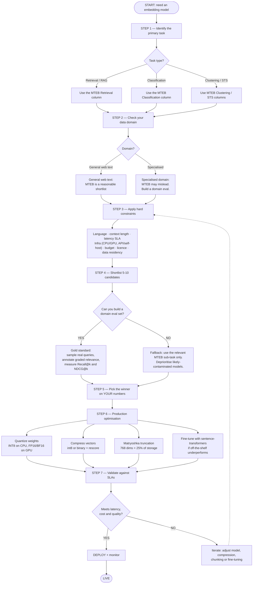

# BERT for Beginners: One Model, Many Jobs

**Embeddings, search, reranking, classification (including few-shot learning with SetFit), NER (including GLiNER for labels you invent on the spot), topic modelling (including the UMAP, HDBSCAN and c-TF-IDF inside BERTopic), question answering, “text generation” (and its limits), fine-tuning, training data, and data drift — explained in plain English**

This guide is a beginner-friendly rewrite of the longer “Fine-Tuning Embedding Models” material. Nothing important was dropped, but every idea is explained with an everyday analogy first, then a small picture, then short code you can run.

**You do not need any machine-learning background.** If you can read a little Python, you can follow along.

## How to use this guide

| If you want to… | Go to |
| --- | --- |
| Understand what BERT actually is | Part 1 |
| See everything BERT can do at a glance | Part 2 |
| Try each job with a few lines of code | Part 3 |
| Teach BERT your own data | Parts 4–6 |
| Prepare training data properly | Part 5 |
| Measure whether it works | Part 7 |
| Keep it working after launch (model drift, MLflow, retraining) | Part 8 |
| Pick the right tool, or look up a word | Part 9 |

## Two labels you will see on code outputs

| Label | Meaning |
| --- | --- |
| **Output (executed)** | I ran this code and this is the real result. |
| **Output (illustrative)** | Realistic, but your exact numbers will differ (model downloads, versions, data). Do not treat as benchmarks. |

## Set-up (one time)

```bash
pip install -U transformers sentence-transformers datasets accelerate scikit-learn \
               seqeval evaluate bertopic keybert peft mlflow
```

For the SetFit, GLiNER and BERTopic sections, add:

```bash
pip install -U setfit gliner umap-learn hdbscan
```

(BERTopic already installs `umap-learn` and `hdbscan`; they are listed so you can import them directly. If pip complains about conflicting package versions, install SetFit and GLiNER into separate virtual environments.)

---

# PART 1 — What Is BERT?

## 1.1 The one-sentence version

> **BERT is a model that reads text and turns it into numbers that capture meaning, taking the surrounding words into account.**

That is the whole idea. Everything else (search, classification, NER, topic modelling…) is just *what you do with those numbers*.

BERT stands for **B**idirectional **E**ncoder **R**epresentations from **T**ransformers. It was released by Google in 2018. “Bidirectional” means it reads the words on **both sides** of a word at once, which is why it understands context so well.

## 1.2 Analogy: a student who learned by doing fill-in-the-blank

Imagine a student locked in a giant library for years. Every day someone hands them a sentence with a few words blacked out and says “guess the missing words.”

```text
   "The doctor told the patient to take the ______ twice a day."
                                           ↑
                                  student guesses: "medicine"
```

After millions of these puzzles, the student never memorised facts on purpose, but they picked up grammar, word meanings, and how ideas connect. That student is BERT. The puzzle game is called **masked language modelling**, and the blacked-out word is a `[MASK]`.

This stage is called **pre-training**. It is done once, by Google or the open-source community, on enormous amounts of text. **You never repeat it.** You download the finished student.

## 1.3 Words become numbers (embeddings)

Computers cannot read words, so BERT turns each piece of text into a list of numbers called a **vector** or **embedding**. Think of it as **GPS coordinates for meaning**: texts that mean similar things get coordinates that are close together.

```text
          meaning space (imagine a map)

         • "puppy"
            • "dog"                            • "invoice"
                                                   • "receipt"

   close on the map  = similar meaning          far apart = unrelated
```

We measure “how close” with **cosine similarity**: 1.0 means pointing the same way (very similar), around 0 means unrelated.

### The magic of context

Old-style word lists gave “bank” one fixed meaning. BERT gives it a **different vector depending on the sentence**:

```python
import torch
from transformers import AutoTokenizer, AutoModel

tok  = AutoTokenizer.from_pretrained("bert-base-uncased")
bert = AutoModel.from_pretrained("bert-base-uncased")

def word_vector(sentence, word):
    inputs = tok(sentence, return_tensors="pt")
    with torch.no_grad():
        hidden = bert(**inputs).last_hidden_state[0]          # one vector per token
    position = tok.convert_ids_to_tokens(inputs["input_ids"][0]).index(word)
    return hidden[position]

money_1 = word_vector("I deposited cash at the bank.", "bank")
money_2 = word_vector("She opened a savings account at the bank.", "bank")
river   = word_vector("We had a picnic on the river bank.", "bank")

cos = torch.nn.functional.cosine_similarity
print("money vs money:", round(cos(money_1, money_2, dim=0).item(), 2))
print("money vs river:", round(cos(money_1, river,   dim=0).item(), 2))
```

**Output (illustrative):**

```text
money vs money: 0.82
money vs river: 0.51
```

Same word, two different meanings, two different vectors. That is what “contextual” means.

## 1.4 Reader versus writer: why BERT is not ChatGPT

There are two big families of text models:

|  | **Encoder** (BERT) | **Decoder** (GPT, Claude, Llama) |
| --- | --- | --- |
| Analogy | A **reader / editor** who studies a whole page at once | A **writer** who produces one word after another |
| Sees | Words on both sides of each word | Only the words written so far |
| Output | Understanding: vectors, labels, spans | New text |
| Best at | Search, classification, NER, matching, clustering | Chatting, writing, summarising, coding |
| Size | Small (110 million parameters for BERT-base) | Large (billions) |

```text
   ENCODER (BERT)                         DECODER (GPT-style)

   text in ─▶ [ reads all at once ] ─▶ numbers / labels      prompt ─▶ [ predicts next word ] ─▶ word ─▶ word ─▶ …
```

This is why “text generation” needs special care with BERT. We cover it honestly in Section3.11.

## 1.5 Pre-training vs fine-tuning

A doctor first completes a **general medical degree**, then trains in **a specialty**. BERT works the same way.

```text
  PRE-TRAINING  (done once, for you)         FINE-TUNING  (what YOU do)
  general reading of millions of pages  ──▶  short, focused practice on YOUR task and YOUR data
  "general degree"                           "specialty training"
```

**Fine-tuning** takes the general model and nudges it with your examples (a few thousand is often enough) so it becomes good at *your* job: your company’s jargon, your categories, your documents. It is cheap compared to training from scratch, often minutes on one GPU.

## 1.6 Three small facts worth knowing

1. **Tokens.** BERT splits text into pieces called *word-pieces*. Rare words get chopped up: `unbelievable` → `un`, `##believ`, `##able`. You do not need to do this yourself; the *tokenizer* does it.
2. **Special tokens.** `[CLS]` is added at the start (its vector often serves as a summary of the whole text), and `[SEP]` marks the end of a sentence, or the border between two sentences.
3. **Length limit.** Classic BERT reads at most **512 tokens** (roughly 350 words) at once. Longer documents must be cut into *chunks*.

```text
   [CLS]  the  doctor  told  the  patient  …  [SEP]
     ↑
   summary slot (used for whole-text jobs like classification)
```

## 1.7 Meet the BERT family

“BERT” is also used as a nickname for a whole family of similar models.

| Model | Plain-English description | Pick it when |
| --- | --- | --- |
| **BERT** (base / large) | The original. Base = 12 layers, \~110M parameters. | Learning, baselines |
| **RoBERTa** | BERT trained longer and better | Often a bit more accurate |
| **DistilBERT** | A smaller, faster “student” copy of BERT | Speed or memory matters |
| **ALBERT** | Shares weights to save memory | Memory-constrained |
| **DeBERTa** | Smarter handling of word position | Highest accuracy at base size |
| **ModernBERT** | A newer rebuild with longer context (thousands of tokens) | Long documents |
| **Domain BERTs** (BioBERT, SciBERT, FinBERT, Legal-BERT) | BERT further trained on medical / science / finance / legal text | Your text is full of jargon |
| **Multilingual BERT / XLM-R** | Reads many languages | Non-English or mixed text |
| **Sentence-BERT models** (`all-MiniLM`, `bge`, `e5`) | BERT-style models re-trained so the *whole sentence* gets a good vector | Search, similarity, clustering |

**Cased or uncased?** *Uncased* models lowercase everything. *Cased* models keep capitals. For NER (finding names) use **cased**, because “Apple” versus “apple” matters.

## 1.8 Your first BERT program (fill in the blank)

```python
from transformers import pipeline

fill = pipeline("fill-mask", model="bert-base-uncased")
for guess in fill("The doctor told the patient to take the [MASK] twice a day.")[:3]:
    print(f"{guess['token_str']:<12} {guess['score']:.2f}")
```

**Output (illustrative):**

```text
medicine     0.31
medication   0.27
pills        0.08
```

Congratulations: you have just run the exact game BERT learned from.

---

# PART 2 — Everything You Can Do With BERT (the Big Map)

## 2.1 One brain, many hats

BERT’s body (the part that understands language) is the same for every job. What changes is a small piece bolted on top, called a **head**. Think of one very well-educated employee who can wear different hats:

```text
  Your text
      |
      v
  BERT body  (understands the text)
      |
      +--> classification head  -->  one label
      +--> tagging head         -->  a tag for every word
      +--> answer head          -->  where the answer is
      +--> no head (vectors)    -->  search, topics, clustering
```

## 2.2 The master table

| # | Job | The everyday question | Output | How BERT does it | Native to BERT? |
| --- | --- | --- | --- | --- | --- |
| 1 | **Embeddings** | “Give me coordinates for this text” | A vector | Body only (use a sentence-BERT model) | Yes |
| 2 | **Semantic search / retrieval** | “Find passages that *mean* what I asked” | Ranked passages | Embed query and documents, compare vectors | Yes |
| 3 | **Reranking** | “Of these 50 results, which are truly best?” | Re-ordered list | Cross-encoder reads query and passage together | Yes |
| 4 | **Text classification** | “Is this positive or negative? Spam? Which topic?” | One label | `[CLS]` vector + classification head | Yes |
| 5 | **Sentence-pair classification** | “Do these two sentences agree? Are they duplicates?” | One label for the pair | Two sentences joined with `[SEP]` | Yes |
| 6 | **Zero-shot classification** | “Label this using categories I just made up” | A label, no training | Pair classification trick (Section 3.5) | Yes (via NLI model) |
| 7 | **NER** | “Highlight every person, place, product” | A tag per word | Token-tagging head | Yes |
| 8 | **POS tagging / chunking** | “Mark nouns, verbs, phrases” | A tag per word | Same head as NER, different labels | Yes |
| 9 | **Extractive question answering** | “Where in this paragraph is the answer?” | A span of the text | Start/end head | Yes |
| 10 | **Fill-in-the-blank** | “Which word fits here?” | Candidate words | Masked-language head | Yes |
| 11 | **Topic modelling** | “What themes are in these 10,000 documents?” | Topic groups with names | BERTopic: embed, shrink (UMAP), cluster (HDBSCAN), name (c-TF-IDF); see Section 3.8a | Yes (add-on) |
| 12 | **Clustering** | “Group similar texts together” | Group IDs | Embed, then K-Means or HDBSCAN | Yes (add-on) |
| 13 | **Keyword extraction** | “What are the key phrases?” | A few phrases | KeyBERT: phrases closest to the document vector | Yes (add-on) |
| 14 | **Extractive summarisation** | “Pick the most important sentences” | A shortlist of sentences | Sentences closest to the document’s centre | Yes (add-on) |
| 15 | **Duplicate / near-duplicate finding** | “Which texts are basically the same?” | Groups of repeats | Embeddings plus a similarity cut-off | Yes |
| 16 | **Multiple choice** | “Which of these four answers fits?” | A choice | Multiple-choice head | Yes |
| 17 | **Drift monitoring** | “Is today’s data different from training?” | An alarm | Compare embeddings over time (Part 8) | Yes (add-on) |
| 18 | **Text generation** | “Write me a paragraph” | New text | **Not what BERT is built for.** Workarounds in Section 3.11 | **No (honest answer)** |
| 19 | **Few-shot classification (SetFit)** | “Label my texts when I have only a handful of examples per category” | One label | A sentence-BERT body fine-tuned on *pairs* of examples, then a small classifier on top (Section 3.5a) | Yes (add-on) |
| 20 | **Zero-shot NER (GLiNER)** | “Highlight entity types I invent right now, with no training” | A span of text with a type | A BERT-style encoder matches word spans against label names (Section 3.6a) | Yes (add-on) |

Rows 1–17, 19 and 20 are BERT’s home turf. Row 18 is where BERT needs help from a different kind of model.

## 2.3 A mental shortcut: what comes out?

```text
   ONE number per text      →  classification, sentiment, relevance score (reranking)
   ONE vector per text      →  search, clustering, topics, duplicates, drift
   ONE tag per WORD         →  NER, POS tagging
   A START and END position →  question answering
   A WORD for a [MASK]      →  fill-in-the-blank
   NEW free-flowing text    →  not BERT; use a decoder (GPT/Claude/Llama)
```

Pick the shape of the output you need and you have picked your BERT job.

---

# PART 3 — Every Job, With a Few Lines of Code

Each section below follows the same pattern: **an analogy**, **a picture**, **code**, **output**. Models download automatically the first time you run them.

## 3.1 Embeddings and similarity (“GPS coordinates for sentences”)

**Analogy:** every sentence gets a pin on a giant map of meaning. Pins that land close together mean similar things, even if the words differ.

```python
from sentence_transformers import SentenceTransformer, util

model = SentenceTransformer("sentence-transformers/all-MiniLM-L6-v2")   # small, fast, BERT-style

sentences = [
    "How do I reset my password?",
    "I forgot my login password.",
    "What is the refund policy?",
]
vecs = model.encode(sentences, normalize_embeddings=True)
print("shape:", vecs.shape)
print(util.cos_sim(vecs, vecs).numpy().round(2))
```

**Output (illustrative):**

```text
shape: (3, 384)
[[1.   0.72 0.12]
 [0.72 1.   0.09]
 [0.12 0.09 1.  ]]
```

Reading the grid: sentence 1 and 2 share no important words, yet score **0.72** (similar). Sentence 3 is about something else, so it scores about **0.1** against both. Each sentence became a list of 384 numbers.

## 3.2 Semantic search / retrieval (“the librarian with index cards”)

**Analogy:** a keyword search is like a librarian who only matches the exact words on a book’s cover. A **semantic search** librarian understands what you *mean*: ask for “car problems” and they also hand you the book about “automobile repairs.”

How it works: write an “index card” (vector) for every document **once**, in advance. When a question arrives, make a card for the question and find the closest document cards.

```text
  ONCE, in advance
    1. Turn every document into a vector
    2. Store the vectors

  EVERY TIME someone asks
    3. Turn the question into a vector
    4. Find the closest document vectors
    5. Return the top matches
```

This design is called a **bi-encoder** (“two separate encodings”: one for the question, one for each document).

```python
docs = [
    "To reset your password, go to Settings > Security > Reset Password.",
    "Refunds are issued within 14 days of purchase if the item is unused.",
    "Go to Settings > Notifications to manage email alerts.",
    "Our office is closed on public holidays.",
]
doc_vecs = model.encode(docs, normalize_embeddings=True)            # done once

query = "I can't log in, how do I change my password?"
q_vec = model.encode(query, normalize_embeddings=True)

for hit in util.semantic_search(q_vec, doc_vecs, top_k=3)[0]:
    print(f"{hit['score']:.2f}  {docs[hit['corpus_id']]}")
```

**Output (illustrative):**

```text
0.64  To reset your password, go to Settings > Security > Reset Password.
0.31  Go to Settings > Notifications to manage email alerts.
0.08  Refunds are issued within 14 days of purchase if the item is unused.
```

Notice the query never says “reset”, and still the right document wins. Notice also the runner-up: the notifications document also says “Go to Settings >”, so it looks similar. Hold that thought for Section 3.3 and Section 6.1.

For millions of documents, store vectors in a *vector database or index* (FAISS, Qdrant, pgvector…) instead of a Python list. The idea is identical.

## 3.3 Reranking (“shortlist, then interview”)

**Analogy:** hiring. Reading 10,000 résumés in depth is impossible, so first a **quick screen** picks 50 candidates (retrieval). Then a **careful interviewer** examines each of the 50 next to the job description (reranking).

The careful interviewer is a **cross-encoder**: it reads the question and the document **together, in one go**, so every word of the question can “look at” every word of the document. Slower, but much more accurate.

```text
  BI-ENCODER  (quick screen)
    question  -> its own vector
    document  -> its own vector   (made in advance)
    then compare the two vectors
    Fast. Works for millions of documents.

  CROSS-ENCODER  (careful interview)
    question + document read together -> one score
    Slow. Use it only on the shortlist.
```

```python
from sentence_transformers import CrossEncoder

reranker = CrossEncoder("cross-encoder/ms-marco-MiniLM-L-6-v2")    # MiniLM = a small BERT-style model

query = "How do I reset my password?"
candidates = [
    "Go to Settings > Notifications to manage email alerts.",
    "To reset your password, go to Settings > Security > Reset Password.",
    "Refunds are issued within 14 days of purchase.",
]
scores = reranker.predict([(query, c) for c in candidates])
for score, text in sorted(zip(scores, candidates), reverse=True):
    print(f"{score:6.2f}  {text}")
```

**Output (illustrative):**

```text
  9.14  To reset your password, go to Settings > Security > Reset Password.
 -4.80  Go to Settings > Notifications to manage email alerts.
 -10.6  Refunds are issued within 14 days of purchase.
```

The scores are raw (not 0–1); only the **order** matters. The look-alike “notifications” answer is pushed far below the correct one.

> **Golden rule:** never run a cross-encoder across your whole library. Two million documents means two million slow reads *per question*. Use the two-stage pattern: bi-encoder to shortlist 50–200, cross-encoder to pick the best few.

## 3.4 Classification (“sorting the mail into pigeonholes”)

**Analogy:** a mailroom worker reads each letter and drops it in a pigeonhole: *complaint*, *invoice*, *spam*. Classification gives each text **one label** from a list you define. Common uses: sentiment, spam detection, intent detection (“what does the customer want?”), routing support tickets.

There are three main ways, from least to most effort (with a few-shot upgrade, SetFit, between B and C):

| Way | Effort | Needs your labelled data? | Use when |
| --- | --- | --- | --- |
| **A. Ready-made model** | One line | No | Standard tasks like sentiment |
| **B. Embeddings + a simple classifier** | 10 lines | A little (tens of examples per class) | Quick, solid baseline; labels change often |
| **B+. SetFit** (Section 3.5a) | About 20 lines | Very little (8–16 per class) | You have only a handful of examples and plain embeddings are not accurate enough |
| **C. Fine-tune BERT** (Part 6) | Moderate | Hundreds to thousands | Best accuracy on your own categories |

**A. Ready-made:**

```python
from transformers import pipeline

sentiment = pipeline("sentiment-analysis",
                     model="distilbert-base-uncased-finetuned-sst-2-english")
print(sentiment(["I love this phone, the battery lasts forever!",
                 "The package arrived broken and support ignored me."]))
```

**Output (illustrative):**

```text
[{'label': 'POSITIVE', 'score': 0.9998}, {'label': 'NEGATIVE', 'score': 0.9994}]
```

**B. Your own categories with embeddings and a simple classifier:**

```python
from sklearn.linear_model import LogisticRegression

train_texts = ["My card was declined", "Payment failed at checkout",
               "I forgot my password", "Can't log in to my account",
               "I want my money back", "How do I return this item?"]
train_labels = ["payment", "payment", "login", "login", "refund", "refund"]

clf = LogisticRegression(max_iter=1000)
clf.fit(model.encode(train_texts, normalize_embeddings=True), train_labels)

new = ["The transaction didn't go through", "Reset my login credentials please"]
print(clf.predict(model.encode(new, normalize_embeddings=True)))
```

**Output (illustrative):**

```text
['payment' 'login']
```

The embedding does the hard work of understanding language; the tiny classifier just draws boundaries between the clouds of points. Adding a new category later means adding a few examples, not retraining BERT.

```text
   embedding space with boundaries drawn by the classifier

     • • payment          │  login  • •
      • •                  │          • •          refund
   ─────────────────────┴──────────────────────────────────  • •
```

> **Only a handful of examples, and way B is not accurate enough?** Section 3.5a (SetFit) goes one step further: it also *moves the pins* on the meaning map so that your categories form clearer clouds before the borders are drawn.

### Sentence-pair classification (“the judge comparing two statements”)

Sometimes the thing you classify is a **pair** of texts: *Do these two sentences agree, contradict, or neither?* (called NLI, natural language inference), or *Are these two support tickets duplicates?* BERT handles this by gluing the two sentences together: `[CLS] sentence A [SEP] sentence B [SEP]`.

```python
nli = CrossEncoder("cross-encoder/nli-deberta-v3-base")
labels = ["contradiction", "entailment", "neutral"]

pairs = [("A man is playing a guitar.", "A person is making music."),
         ("A man is playing a guitar.", "Nobody is playing anything.")]
for pair, scores in zip(pairs, nli.predict(pairs)):
    print(labels[scores.argmax()], "←", pair[1])
```

**Output (illustrative):**

```text
entailment ← A person is making music.
contradiction ← Nobody is playing anything.
```

## 3.5 Zero-shot classification (“classify with no training data”)

**Analogy:** a new employee gets a menu of categories on their first day and sorts mail correctly without any training, simply by *asking themselves* “does this letter fit ‘billing’?”

The trick: turn each category into a yes/no question using the pair judge from above (“This text is about *billing*” → does the text support that statement?).

```python
zero = pipeline("zero-shot-classification", model="facebook/bart-large-mnli")
result = zero("My invoice shows the wrong amount.",
              candidate_labels=["billing", "shipping", "technical problem"])
print(result["labels"][0], round(result["scores"][0], 2))
```

**Output (illustrative):**

```text
billing 0.91
```

(That specific model is BART-based; the same idea works with BERT-family NLI models such as DeBERTa. Zero-shot is great to start with and to bootstrap labels, but a fine-tuned model on your own data is usually more accurate.)

## 3.5a SetFit: few-shot classification (“a few examples, turned into many pairs”)

**The situation.** You have your own categories, but only a **handful of labelled examples** for each (say 8 support tickets per category), because labelling is slow and costly. Zero-shot (Section 3.5) needs no examples, but it is often not accurate enough on *your* categories. A normal fine-tune (Section 6.2) wants hundreds per category. **SetFit** is built for the gap in between: *dozens of examples, not thousands.*

SetFit is short for **S**entence **T**ransformer **Fi**ne-**t**uning. It was published in 2022 by Hugging Face and partners in a paper called “Efficient Few-Shot Learning Without Prompts.”

### The idea: ask “do these two belong together?”

**Analogy:** you hire a new librarian and can only show them **four books per shelf**. If you say “memorise this: this book goes on shelf 3”, four books teach them very little. So you change the game. You hold up *two* books and ask a much easier question: **“Do these two belong on the same shelf?”** Twelve books can be paired up in 66 different ways, so twelve examples turn into **66 small lessons**. After enough lessons the librarian has a feel for what “belongs together” means in *your* library. Only then do you paint the labels on the shelves.

That is exactly SetFit’s recipe. It has two stages:

```text
  STAGE 1  Reshape the meaning map          (the body learns from PAIRS)

    12 labelled texts ──▶ make pairs ──▶ ("card declined", "payment failed")     same class → 1.0
                                         ("card declined", "forgot password")    different  → 0.0

    Training pulls same-class pins together and pushes different-class pins apart.

  STAGE 2  Draw the borders                 (the head learns the labels)

    embed each labelled text with the reshaped body ──▶ fit a LogisticRegression
```

```text
   BEFORE stage 1                              AFTER stage 1

     • payment   • login                         • •  payment            • •  login
        • refund   • payment                      •
      • login    • refund                                   • •  refund
                                                             •
   clouds overlap, borders are hard            clouds are apart, a simple border works
```

The training style in stage 1 is called **contrastive learning**: learn by *contrast* (“these two are alike, those two are not”) rather than by naming things.

**How is this different from way B in Section 3.4?** Way B kept the meaning map **frozen** and only drew borders (that is stage 2 alone). SetFit adds stage 1: it first **moves the pins** so your categories form clearer clouds. With very few examples, that is often the difference between “okay” and “good.”

### The ideology: why this works with so little data

1. **Learn by comparing, not by naming.** “Are these two alike?” is an easier question than “which of 20 categories is this?”, and it needs less data to answer.
2. **Squeeze many lessons out of every example.** *N* labelled texts make about *N*²/2 pairs, so the body sees far more training signals than you have examples.
3. **Stay small and prompt-free.** No giant model, and no hand-written prompts such as “Does this ticket sound like a refund? Answer yes or no.” The body is a small sentence-transformer (the family from Section 3.1) and the head is plain scikit-learn. Training takes minutes and predictions take milliseconds.

In the authors’ experiments, a few examples per class were often competitive with fine-tuning much larger models on far more data. Treat that as encouraging, not as a promise: **your own locked exam (Part 7) decides.**

### See the pair-making with your own eyes

This is the idea in plain Python. No model is needed:

```python
from itertools import combinations

texts = [
    "My card was declined", "Payment failed at checkout", "The transaction did not go through", "Charged twice for one order",
    "I forgot my password", "Cannot log in to my account", "Reset my login credentials", "Locked out of my account",
    "I want my money back", "How do I return this item?", "Please refund my order", "Send the refund to my card",
]
labels = ["payment"] * 4 + ["login"] * 4 + ["refund"] * 4

pos, neg = [], []
for (i, a), (j, b) in combinations(list(enumerate(texts)), 2):
    (pos if labels[i] == labels[j] else neg).append((a, b))

n = max(len(pos), len(neg))
print(f"labelled examples        : {len(texts)}")
print(f"possible pairs           : {len(pos) + len(neg)}")
print(f"  same class (label 1.0) : {len(pos)}")
print(f"  different  (label 0.0) : {len(neg)}")
print(f"balanced training set    : {n} positive + {n} negative = {2 * n} pairs")
```

**Output (executed):**

```text
labelled examples        : 12
possible pairs           : 66
  same class (label 1.0) : 18
  different  (label 0.0) : 48
balanced training set    : 48 positive + 48 negative = 96 pairs
```

Twelve examples became 66 possible pairs. Different-class pairs (48) outnumber same-class pairs (18), so SetFit’s default strategy, `"oversampling"`, **repeats positive pairs** until the two kinds are equal in number: 48 + 48 = 96 lessons.

> **Watch the growth.** Pairs grow with the *square* of your data: 12 examples give 66 pairs, 100 give 4,950, 1,000 give 499,500. Training time grows with them. If it gets slow, cap the number of pairs with `num_iterations` (see the knobs below).

### The real thing

```python
from datasets import Dataset
from setfit import SetFitModel, Trainer, TrainingArguments

label_names = ["payment", "login", "refund"]

train_ds = Dataset.from_dict({
    "text":  texts,                                    # the 12 examples from above
    "label": [0] * 4 + [1] * 4 + [2] * 4,              # 0 = payment, 1 = login, 2 = refund
})
exam_ds = Dataset.from_dict({                          # the locked exam: never used for training (Part 7)
    "text":  ["The payment keeps failing", "I can't sign in", "I'd like to return my purchase",
              "Why was I charged twice?", "Password reset email never came", "Give me a refund please"],
    "label": [0, 1, 2, 0, 1, 2],
})

model = SetFitModel.from_pretrained("sentence-transformers/all-MiniLM-L6-v2", labels=label_names)

args = TrainingArguments(batch_size=16, num_epochs=1)  # one pass over the pairs is usually enough
trainer = Trainer(model=model, args=args, train_dataset=train_ds, eval_dataset=exam_ds)
trainer.train()                                        # stage 1 (pairs) and stage 2 (head) happen automatically

print(trainer.evaluate())

new = ["The transaction didn't go through", "Reset my login credentials please", "Money back, please"]
print(model.predict(new))
print(model.predict_proba(new, as_numpy=True).round(2))

model.save_pretrained("output/my-setfit-model")        # reload later with SetFitModel.from_pretrained(...)
```

**Output (illustrative):**

```text
{'accuracy': 1.0}
['payment', 'login', 'refund']
[[0.88 0.07 0.05]
 [0.06 0.89 0.05]
 [0.05 0.06 0.89]]
```

A six-question exam is only for the demo. A real exam needs far more, ideally 30–50 per category, **even though training uses only 8**. Score it like any classifier: macro-F1 on the locked exam (Section 7.2).

The `labels=` argument just tells SetFit the names to hand back. Without it, `predict` returns the numbers 0, 1, 2.

### The knobs

| Knob | Plain-English meaning | Start with |
| --- | --- | --- |
| **Base model** | The sentence-transformer whose map gets reshaped | `all-MiniLM-L6-v2` (fast); a bigger one such as `paraphrase-mpnet-base-v2` or a `bge` model if you can wait |
| `num_epochs` | Passes over the pairs in stage 1 | 1 |
| `batch_size` | Pairs per training step | 16 |
| `num_iterations` | Fixes the number of pairs at `num_iterations × N × 2`, overriding the “use every pair” default | Leave unset for tiny data; try 20 once you have hundreds of examples |
| `sampling_strategy` | How pairs are drawn: `"oversampling"` (default), `"undersampling"`, `"unique"` | The default |
| `labels=` | The category names that `predict` returns | Your own names |

### Tips and traps

- **Pick examples for variety, not volume.** Eight *different* ways of asking for a refund teach more than eight near-copies of the same sentence.
- **Keep every label clean.** With 8 examples, one wrong label is 12% of the class, and contrastive training will faithfully learn the mistake.
- **Ask “how few is enough?” with data, not hope.** Train with 4, 8, 16 and 32 examples per class, score each on the same locked exam, and stop when the curve flattens. It also tells you how many labels are worth buying. `sample_dataset(ds, label_column="label", num_samples=8)` draws a fixed number per class from a bigger labelled set.
- **More than one label per text?** Use `SetFitModel.from_pretrained(..., multi_target_strategy="one-vs-rest")`.
- **No examples at all?** `setfit.get_templated_dataset` can invent training sentences from label names (“This sentence is about billing”), but zero-shot (Section 3.5) is simpler. Use SetFit once you have real examples.
- **Long texts.** The body has a length limit (often 256 tokens for MiniLM-style models, see Section 1.6). Chunk long documents (Section 5.3).
- **Outgrowing it.** With hundreds of examples per category, a normal fine-tune (Section 6.2) often catches up. Compare both on your exam.

### Which classification tool for which situation?

| What you have | Reach for | Section |
| --- | --- | --- |
| No labelled examples, categories invented today | Zero-shot with an NLI model | Section 3.5 |
| Tens of examples, labels change every week, no time to train | Embeddings + `LogisticRegression` | Section 3.4 (way B) |
| **About 8–50 examples per category** | **SetFit** | **this section** |
| Hundreds or more per category | Fine-tune BERT with a classification head | Section 6.2 |

## 3.6 NER: Named Entity Recognition (“highlighter pens”)

**Analogy:** read a news article with coloured highlighters: yellow for **people**, blue for **companies**, green for **places**. NER does exactly that automatically: it marks **which words are which kind of thing**.

```text
  Tim Cook  said  Apple  will open a store in  Mumbai .
  └─PERSON─┘        └ORG─┘                       └LOC──┘
```

```python
ner = pipeline("ner", model="dslim/bert-base-NER", aggregation_strategy="simple")
for e in ner("Tim Cook said Apple will open a store in Mumbai."):
    print(f"{e['entity_group']:<5} {e['word']:<10} {e['score']:.2f}")
```

**Output (illustrative):**

```text
PER   Tim Cook   1.00
ORG   Apple      1.00
LOC   Mumbai     1.00
```

**How the labels work (BIO, in one minute).** The model gives every word one tag:

| Tag | Meaning | Memory trick |
| --- | --- | --- |
| `B-PER` | **B**eginning of a person | “Begin a new highlight” |
| `I-PER` | **I**nside the same person | “Keep highlighting” |
| `O` | **O**utside, not an entity | “Pen off the page” |

```text
 words:  Tim     Cook    said   Apple   will   open
 tags:   B-PER   I-PER   O      B-ORG   O      O
```

The `B`/`I` split lets the model tell two neighbouring names apart.

**POS tagging** (noun, verb, adjective…) and **chunking** use the very same “one tag per word” head; only the label list is different. NER is also what you fine-tune to find *your* entities: product names, order IDs, drug names (Section 6.3). And if you want to find entity types you invent on the spot, with no training at all, see GLiNER in Section 3.6a.

## 3.6a GLiNER: NER with labels you invent on the spot (“highlighters you can swap mid-page”)

**The problem with classic NER.** The NER model in Section 3.6 learned a **fixed menu** of labels during training: `PER`, `ORG`, `LOC`. Want to find `DRUG` or `FLIGHT_NUMBER` as well? You need labelled examples and a new training run (Section 6.3). An LLM could do it from a prompt, but it is slow and costly when you have a million documents.

**GLiNER** (**G**eneralist and **Li**ghtweight model for **NER**, published in 2023) removes the fixed menu. **You hand it the label names at the moment you ask**, as plain words, and it highlights whatever matches them. No training, no new labelled data.

### The idea: a sticky note at the top of the page

**Analogy:** in Section 3.6 the highlighter worker was trained with exactly three colours. If you want a fourth colour, they must go back to school. GLiNER’s worker is different: before each page you stick a **note on top** saying “Today, highlight: *person, medicine, flight number*.” They read the note, then read the page. Change the note and the behaviour changes, with no school in between.

### The concept, in three ideas

1. **Labels are input, not output.** Classic NER ends in a fixed list of tag slots. GLiNER puts the label names *into the text it reads*, next to the passage, so the same model can serve any label list.
2. **Match phrases to labels on the meaning map.** This is the “GPS coordinates” idea from Section 1.3 again. GLiNER gives every **candidate span** (a run of up to 12 words) a pin, and every label name a pin on the same map. A span is an entity of type *X* when its pin lands close to the pin for *X*.
3. **Train on a huge variety of labels.** GLiNER was trained on tens of thousands of passages whose entities were labelled by an LLM, covering *thousands* of different entity types. It did not memorise particular labels. It learned **what it means to match a label name**, which is why labels it has never seen still work.

Under the hood it is a **bidirectional encoder**, the same family as BERT (the original release used a DeBERTa backbone), which is why it belongs in this guide. It is small (tens to hundreds of millions of parameters) and runs on a CPU. It scores all spans and all labels in **one pass**, instead of writing an answer word by word like an LLM.

```text
  What the encoder reads (labels first, then the text):

  [ENT] person [ENT] company [ENT] city [SEP]  Tim Cook said Apple will open a store in Mumbai
        └─ label cards ─────────────────┘      └─ the passage ─────────────────────────────┘
                                                              │
                      build one vector for every span of up to 12 words
                      "Tim"  "Tim Cook"  "Tim Cook said"  …  "Apple"  …  "Mumbai"
                                                              │
                   score(span, label) = sigmoid( span vector · label vector )
                                                              │
                          keep the pairs scoring above the threshold (0.5 by default)
```

**Try the idea in a few lines.** First, how many spans does the model have to judge? Then the matching step, using made-up 2-D vectors so you can see the arithmetic:

```python
import numpy as np

words = "Tim Cook said Apple will open a store in Mumbai".split()
W = 3                                              # real GLiNER uses a maximum span width of 12

spans = [(i, j) for i in range(len(words)) for j in range(i, min(i + W, len(words)))]
print(f"{len(words)} words, max width {W} -> {len(spans)} candidate spans")

labels = {"person": np.array([1.0, 0.0]), "company": np.array([0.0, 1.0])}
span_vecs = {"Tim Cook": np.array([2.5, -0.5]),    # pretend the encoder produced these
             "Apple": np.array([-0.3, 2.2]),
             "will open": np.array([-1.0, -1.0])}

sigmoid = lambda x: 1 / (1 + np.exp(-x))
print(f"\n{'span':<11}" + "".join(f"{l:>9}" for l in labels) + "   decision (threshold 0.5)")
for s, v in span_vecs.items():
    scores = {l: sigmoid(v @ lv) for l, lv in labels.items()}
    hits = [l for l, p in scores.items() if p >= 0.5]
    print(f"{s:<11}" + "".join(f"{p:9.2f}" for p in scores.values()) + f"   {hits[0] if hits else '-'}")
```

**Output (executed; the vectors are made-up toy numbers):**

```text
10 words, max width 3 -> 27 candidate spans

span          person  company   decision (threshold 0.5)
Tim Cook        0.92     0.38   person
Apple           0.43     0.90   company
will open       0.27     0.27   -
```

Read it like a matching game: “Tim Cook” is close to the *person* card (0.92), “Apple” is close to the *company* card (0.90), and “will open” matches neither, so it stays un-highlighted. With a real 300-word text and a width of 12 there are about 3,500 candidate spans, and the model scores all of them against all your labels at once.

### Your first GLiNER program

```python
from gliner import GLiNER

model = GLiNER.from_pretrained("urchade/gliner_medium-v2.1")        # small / medium / large / multi (many languages) exist

text   = "Tim Cook said Apple will open a store in Mumbai on 5 March 2027."
labels = ["person", "company", "city", "date"]

for e in model.predict_entities(text, labels, threshold=0.5):
    print(f"{e['label']:<8} {e['text']:<14} {e['score']:.2f}   chars {e['start']}-{e['end']}")
```

**Output (illustrative):**

```text
person   Tim Cook       0.98   chars 0-8
company  Apple          0.97   chars 14-19
city     Mumbai         0.96   chars 41-47
date     5 March 2027   0.91   chars 51-63
```

Each result is a small dictionary with `text`, `label`, `score`, and the character positions `start` and `end`. These are ordinary Python slice positions: `text[e["start"]:e["end"]]` gives back `e["text"]`.

**Now the headline trick: same model, brand-new labels, zero training.**

```python
text   = "Take 500 mg of paracetamol twice a day for fever."
labels = ["drug", "dosage", "frequency", "symptom"]
for e in model.predict_entities(text, labels, threshold=0.4):
    print(f"{e['label']:<10} {e['text']:<13} {e['score']:.2f}")
```

**Output (illustrative):**

```text
drug       paracetamol   0.95
dosage     500 mg        0.93
frequency  twice a day   0.88
symptom    fever         0.90
```

To process many texts at once, use `model.batch_predict_entities(list_of_texts, labels, threshold=0.5)`.

### Getting the best out of it

| Knob | What it does | Advice |
| --- | --- | --- |
| `threshold` | Minimum score to keep a span (default 0.5) | The metal-detector dial from Section 7.2: lower finds more treasure and more false beeps. Tune it on your exam, **per project**. |
| Label wording | The label text *is* the instruction | Plain words work best: `person` rather than `PER`; `medicine name` or `flight number` rather than `MED` or `FLT`. Be specific. |
| Number of labels | How many types you ask for at once | Start with the handful you truly need. A very long label list makes each decision harder. |
| `flat_ner=True` (default) | No overlapping entities | Leave on unless you really need nested ones. |
| `multi_label=True` | Allow one span to carry several labels | Off by default. |
| Text length | The model reads about 384 tokens at once by default | **Chunk long documents** (Section 5.3). Entities cut at a chunk boundary can be missed, so overlap the chunks a little. |

### From “no training” to “a model that is yours”

GLiNER is a superb **starting point**, but on a narrow domain a model trained on your own data usually wins. A healthy pattern, the same “bootstrap with a big model” idea as Section 11.2:

```text
  1. Run GLiNER on 1,000–2,000 of your texts                 (minutes, no labels needed)
  2. Convert its answers into BIO tags (Section 5.4)                  (below)
  3. Have a person CORRECT them in an annotation tool          (much faster than labelling from scratch)
  4. Fine-tune a cased BERT NER model on the corrected data    (Section 6.3)
  5. Score on a locked, fully human-checked exam with seqeval  (Section 6.3, Part 7)
```

GLiNER’s character positions are exactly what the `spans_to_bio` function from Section 5.4 expects. Here it is turning GLiNER-shaped results into word-level tags (the entity dictionaries are written by hand in GLiNER’s output format, so you can run this without a model):

```python
import re

def spans_to_bio(text, spans):                    # the same function as in Section 5.4
    tokens, tags = [], []
    for m in re.finditer(r"\w+|[^\w\s]", text):
        tag = "O"
        for s, e, label in spans:
            if s <= m.start() < e:
                tag = ("B-" if m.start() == s else "I-") + label
                break
        tokens.append(m.group()); tags.append(tag)
    return tokens, tags

text = "Tim Cook said Apple will open a store in Mumbai on 5 March 2027."
found = [{"start": 0,  "end": 8,  "text": "Tim Cook",     "label": "person"},
         {"start": 14, "end": 19, "text": "Apple",        "label": "company"},
         {"start": 41, "end": 47, "text": "Mumbai",       "label": "city"},
         {"start": 51, "end": 63, "text": "5 March 2027", "label": "date"}]

spans = [(e["start"], e["end"], e["label"].upper()) for e in found]
for tok, tag in zip(*spans_to_bio(text, spans)):
    print(f"{tok:<7}{tag}")
```

**Output (executed):**

```text
Tim    B-PERSON
Cook   I-PERSON
said   O
Apple  B-COMPANY
will   O
open   O
a      O
store  O
in     O
Mumbai B-CITY
on     O
5      B-DATE
March  I-DATE
2027   I-DATE
.      O
```

You can also **fine-tune GLiNER itself** on your own data instead of switching to plain BERT. Its training examples use the same “highlight, then convert” idea, but with word positions instead of tags:

```python
{"tokenized_text": ["Tim", "Cook", "said", "Apple", "will", "open"],
 "ner": [[0, 1, "person"], [3, 3, "company"]]}      # [first word, last word (inclusive), label]
```

The training loop lives in the GLiNER repository (see Section 11.8); follow its current instructions, because the project changes quickly.

### Which NER tool for which situation?

| | Regex / name list | Fine-tuned BERT NER (Section 6.3) | **GLiNER** | LLM with a prompt |
| --- | --- | --- | --- | --- |
| Add a new entity type | Write a pattern | Label data, retrain | **Change a label string** | Change the prompt |
| Needs labelled data | No | Yes (50–500+ per type) | **No** (only for your exam) | No |
| Speed per text | Instant | Milliseconds | Milliseconds to tens of ms | Seconds |
| Cost at scale | None | Low | Low (runs on CPU) | Highest |
| Accuracy on your narrow domain | Excellent for fixed formats | **Best once trained** | Good start, rarely the ceiling | Good, but can vary |
| Same answer every time | Yes | Yes | Yes | Not always |

**Rules of thumb:**

- Strict formats (order IDs, emails, phone numbers): **a regex beats everything.** Do not spend a model on `ORD-48213`.
- Unknown or changing entity types, or a first look at a new corpus: **GLiNER.**
- Stable entity types and a lot of volume: **a fine-tuned model**, bootstrapped by GLiNER.

### Honest limits

- **It is a good generalist, not a specialist.** On narrow jargon, expect fine-tuned models to pull ahead. Measure with entity-level F1 per type (Section 6.3) on a locked exam, never by eyeballing a few examples.
- **Scores can be confidently wrong** on brand-new names (Section 8.4), and results shift with the threshold and with how you word a label. Re-check both when your data changes.
- **Language.** Pick a `multi` checkpoint for non-English text.
- **Licences vary between checkpoints.** Read the model card before shipping commercially.
- **Models keep changing.** The names above were current when this section was written. Check the model hub for newer GLiNER releases.

## 3.7 Extractive question answering (“highlight the answer”)

**Analogy:** an open-book exam where you may only *underline* the answer in the textbook, not write your own. Give BERT a paragraph and a question; it points to the start and end of the answer inside the paragraph.

```python
qa = pipeline("question-answering", model="distilbert-base-cased-distilled-squad")
context = "Apollo 11 landed on the Moon on July 20, 1969. Neil Armstrong was the first to step onto the surface."
print(qa(question="When did Apollo 11 land on the Moon?", context=context))
```

**Output (illustrative):**

```text
{'score': 0.97, 'start': 31, 'end': 44, 'answer': 'July 20, 1969'}
```

**Limits:** the answer must literally appear in the text. This copies, it does not explain or combine information. For “write me a short answer in my own words”, see Section 3.11.

## 3.8 Topic modelling with BERTopic (“sorting a pile of photos”)

**Analogy:** you inherit a shoebox of 10,000 unlabelled photos. You would (1) look at each, (2) put similar ones into piles, (3) write a name on each pile (“beach holidays”, “birthdays”). **BERTopic** does the same with documents.

```text
  documents ─▶ 1. EMBED      ─▶ 2. SHRINK      ─▶ 3. GROUP       ─▶ 4. NAME THE GROUPS
               (BERT: each     (UMAP: flatten     (HDBSCAN: find    (c-TF-IDF: pick the
                text → vector)  to a few dims)     dense piles)      words most special
                                                                       to each pile)
```

Old-style topic models (LDA) just counted words. Because BERTopic starts from *meaning* vectors, “doctor” and “physician” land in the same pile. Curious what UMAP, HDBSCAN and c-TF-IDF really do? Run the example below first, then read Section 3.8a.

```python
from sklearn.datasets import fetch_20newsgroups
from bertopic import BERTopic

docs = fetch_20newsgroups(subset="all", remove=("headers", "footers", "quotes"))["data"][:3000]

topic_model = BERTopic(verbose=False)
topics, probs = topic_model.fit_transform(docs)

print(topic_model.get_topic_info().head(5)[["Topic", "Count", "Name"]])
```

**Output (illustrative):**

```text
   Topic  Count                         Name
0     -1    910            -1_the_to_of_and
1      0    231      0_game_team_he_season
2      1    187   1_space_nasa_orbit_launch
3      2    152   2_god_jesus_bible_church
4      3    131  3_car_engine_bike_oil
```

**Reading the table:** each row is a pile. The name is built from the pile’s most characteristic words. **Topic -1 is the “miscellaneous” bin** for documents that fit no pile; it is normal for it to be large.

```python
print(topic_model.get_topic(1)[:5])          # top words of topic 1 with weights
print(topic_model.transform(["NASA plans a new Mars mission"])[0])   # which pile does a new doc join?
```

**Tips for beginners:**

- You need at least a few hundred documents; hundreds of thousands work fine.
- Too many tiny topics? `BERTopic(nr_topics=20)` merges them. Too few? Lower `min_topic_size`.
- You can plug in your own (e.g. fine-tuned) embedding model: `BERTopic(embedding_model=model)`.
- BERTopic can also track topics **over time**, which is a neat way to spot new themes appearing (see Part 8 on drift).

## 3.8a BERTopic under the hood: UMAP, HDBSCAN and c-TF-IDF (“what happens inside the four boxes”)

In Section 3.8 you ran BERTopic in a few lines and got topics. This section opens each of the four boxes, so that when the topics look wrong you know **which dial to turn**.

Back to the shoebox of 10,000 unlabelled photos:

| Step | Tool | The photo-pile job | The question it answers |
| --- | --- | --- | --- |
| 1. Embed | A sentence-BERT model | Give every photo GPS coordinates | “What does each text mean?” |
| 2. Shrink | **UMAP** | Flatten a globe into a flat atlas | “Can I see the neighbourhoods without 384 directions?” |
| 3. Group | **HDBSCAN** | Look down at a city at night: crowds of lights are piles, lone lights are strays | “Where are the crowds, and who is wandering alone?” |
| 4. Name | **c-TF-IDF** | Glue each pile onto one scrapbook page and ask which words are special to it | “What is each pile about?” |

```text
  texts ─▶ EMBED ─▶ UMAP ─▶ HDBSCAN ─▶ c-TF-IDF ─▶ topics
           (BERT)   (flat    (crowds     (name each
                     atlas)   and strays)  pile)
           384 numbers  5 numbers  topic id or -1  top words
```

> **The key idea:** steps 1–3 decide **who sits in which pile**. Step 4 only decides **what to call the pile**. The names never influence the grouping. That is why you can rename topics in seconds without re-clustering anything (shown below).

### Step 1: Embed (the part you already know)

Every text becomes a list of numbers that captures its meaning, exactly as in Section 1.3 and Section 3.1. By default BERTopic uses a small sentence-transformer (`all-MiniLM-L6-v2`, 384 numbers per text), and you can plug in any other embedding model, including one you fine-tuned (Section 6.5). **Everything after this step is only as good as these vectors**: if two themes land on top of each other here, no later step can pull them apart.

### Step 2: UMAP (“flatten the globe”)

**Why shrink at all?** Embeddings have hundreds of directions, and in that many directions something odd happens: **“near” and “far” blur together.** Every point ends up roughly the same distance from every other point, so there are no clear crowds left to find. Watch:

```python
import numpy as np, umap
rng = np.random.default_rng(1)

for dim in (2, 384):
    pts = rng.normal(size=(500, dim))
    d = np.linalg.norm(pts - pts[0], axis=1)[1:]          # distance from point 0 to all others
    print(f"{dim:>3} dims: nearest {d.min():5.2f}  farthest {d.max():5.2f}  farthest/nearest = {d.max()/d.min():6.1f}")
```

**Output (executed):**

```text
  2 dims: nearest  0.12  farthest  4.81  farthest/nearest =   40.6
384 dims: nearest 25.41  farthest 30.74  farthest/nearest =    1.2
```

On a flat 2-D map the farthest point is about 40 times farther than the nearest, so crowds stand out. In 384 dimensions it is only 1.2 times: everything is “about equally far.”

**Analogy:** a **flat atlas of the globe**. You cannot flatten a sphere without some distortion, but a good map makes sure that **towns that are neighbours on the globe are still neighbours on the page.** UMAP (**U**niform **M**anifold **A**pproximation and **P**rojection) does that for your 384-number vectors.

**How it works, in three plain steps:**

1. For every text, find its closest few neighbours in the big space (how many: `n_neighbors`).
2. Tie a **string** between each text and its neighbours: short strings (very close) are strong, long ones are weak. The result is a web of friendships.
3. Scatter the points in the small space (say 5 numbers each), then nudge them until the web there looks as much like the web in the big space as possible: friends pull together, strangers drift apart.

```python
# (same script, continued) fake "document embeddings": 3 topics in 384 dimensions, with lots of noise
D, per = 384, 200
centres = rng.normal(size=(3, D))
X = np.vstack([c + 2.2 * rng.normal(size=(per, D)) for c in centres])
true = np.repeat([0, 1, 2], per)                           # the hidden truth, used only to check the result
print("embeddings shape:", X.shape)

reducer = umap.UMAP(n_neighbors=15, n_components=5, min_dist=0.0, metric="cosine", random_state=42)
Z = reducer.fit_transform(X)
print("after UMAP      :", Z.shape)
```

**Output (executed):**

```text
embeddings shape: (600, 384)
after UMAP      : (600, 5)
```

These are BERTopic’s own default settings:

| Setting (BERTopic default) | What it means | How to think about it |
| --- | --- | --- |
| `n_neighbors` (15) | How many neighbours each text looks at | **Small** = local detail, many small topics. **Large** = big picture, fewer and broader topics. |
| `n_components` (5) | How many numbers per text after shrinking | Use 5 for *clustering*. For a *picture*, make a second, separate 2-D UMAP. |
| `min_dist` (0.0) | How tightly points may pack | 0.0 packs crowds tightly, which makes them easier for HDBSCAN to see. |
| `metric` (`"cosine"`) | How closeness is measured | Cosine, as in Section 3.1. |
| `random_state` (none) | Repeatability | UMAP uses randomness, so topics can change from run to run. Set `random_state=42` for stable results (a little slower). |

> **Don’t over-read a 2-D UMAP picture.** Tight blobs are meaningful. But the *distance between* blobs, and how big a blob looks, are not reliable. Use pictures to explore, not to prove.

### Step 3: HDBSCAN (“find the crowds, leave the strays alone”)

HDBSCAN stands for **H**ierarchical **D**ensity-**B**ased **S**patial **C**lustering of **A**pplications with **N**oise. Each word earns its place:

- **Density-based:** a topic is a *crowd*, a spot where many points sit close together.
- **Hierarchical:** it does not judge the crowd at one fixed setting. It watches what happens at *every* level of crowdedness.
- **With noise:** points that never belong to a real crowd are **not forced into a pile**. They get the label **`-1`**. This is the “miscellaneous” topic from Section 3.8.

**Analogy: a rising flood.** Picture the map as a landscape in which crowded spots are hills. Start with the sea at its lowest: all the land is one big continent (everything is one cluster). Now raise the water step by step. The continent splits into smaller islands, and little hills sink out of sight. HDBSCAN watches the **whole flood** and keeps the islands that **stayed above water the longest** and were **big enough to matter**. Whoever lives on a drowned hill or the flat coast is **noise**.

**The same thing in four plain steps:**

1. Measure how crowded each point’s surroundings are (the “high ground”).
2. Join points into a family tree, closest and most crowded first, so you can see the crowds merge and split as the “water” rises.
3. Throw away any island with fewer than `min_cluster_size` points. It is too small to be a topic.
4. Of the islands that remain, keep the ones that stayed distinct the longest. Everyone else gets `-1`.

**Why not just K-Means (Section 3.9)?**

| | K-Means | HDBSCAN |
| --- | --- | --- |
| Must you say how many piles? | **Yes** | **No** (you say how small a pile may be) |
| Strays | Forced into the nearest pile | Labelled `-1` |
| Shape of a pile | Round blobs | Any shape |
| Piles of different sizes and densities | Struggles | Copes |

You can see the difference on three real piles plus 60 scattered strays:

```python
import numpy as np
from sklearn.datasets import make_blobs
from sklearn.cluster import KMeans
import hdbscan

rng = np.random.default_rng(0)
X, _ = make_blobs(n_samples=[150, 150, 150], centers=[(-6, 0), (0, 6), (6, 0)], cluster_std=0.8, random_state=0)
X = np.vstack([X, rng.uniform(-10, 10, size=(60, 2))])           # 60 strays scattered everywhere

km = KMeans(n_clusters=3, n_init="auto", random_state=0).fit(X)
print("KMeans pile sizes :", np.bincount(km.labels_))

labels = hdbscan.HDBSCAN(min_cluster_size=30).fit_predict(X)
print("HDBSCAN pile sizes:", [int(np.sum(labels == k)) for k in sorted(set(labels) - {-1})],
      "| noise (-1):", int(np.sum(labels == -1)))
```

**Output (executed):**

```text
KMeans pile sizes : [167 174 169]
HDBSCAN pile sizes: [159, 161, 155] | noise (-1): 35
```

K-Means had to be told “3”, and it pulled every stray into a pile: each pile grew to around 170 instead of 150. HDBSCAN found three piles on its own, kept them close to their true size, and **set 35 strays aside**.

Now the payoff: HDBSCAN on the shrunken 5-number map from step 2.

```python
# (same script as UMAP, continued)
labels = hdbscan.HDBSCAN(min_cluster_size=20).fit_predict(Z)
for k in sorted(set(labels)):
    name = "noise" if k == -1 else f"pile {k}"
    print(f"{name:<7}: {np.sum(labels == k):>3}   true topics inside: {np.bincount(true[labels == k], minlength=3).tolist()}")
```

**Output (executed):**

```text
pile 0 : 200   true topics inside: [0, 0, 200]
pile 1 : 200   true topics inside: [200, 0, 0]
pile 2 : 200   true topics inside: [0, 200, 0]
```

Three piles, each containing exactly one of the hidden topics. Embeddings with a lot of noise were turned into clean piles by UMAP followed by HDBSCAN. (Real text is messier than this tidy fake, so expect some strays.)

**The HDBSCAN dials:**

| Setting (BERTopic default) | What it means | How to think about it |
| --- | --- | --- |
| `min_cluster_size` (10; in BERTopic it is called `min_topic_size`) | The smallest pile that counts as a topic | **Raise** it for fewer, bigger topics (and more noise). **Lower** it for more, smaller topics. |
| `min_samples` (same as `min_cluster_size`) | How picky it is about what counts as “crowded” | **Raise** it and more points become noise. **Lower** it and fewer do. |
| `cluster_selection_method` (`"eom"`) | Which islands to keep | `"eom"` keeps big, lasting islands. `"leaf"` keeps many small ones. |

**What about the big `-1` pile?** A third or more of your documents in topic −1 is common and not a bug: those texts did not sit in any crowd. You can leave them, or hand each stray to its nearest topic, at the price of blurrier topics:

```python
new_topics = topic_model.reduce_outliers(docs, topics)       # give each stray to its nearest topic
topic_model.update_topics(docs, topics=new_topics)           # recompute the names with the new members
```

### Step 4: c-TF-IDF (“which words are special to this pile?”)

**First, ordinary TF-IDF**, which is just two ideas multiplied together:

- **TF** (term frequency): how often a word appears *here*.
- **IDF** (inverse document frequency): how *rare* the word is everywhere else.

A word that is common here and rare elsewhere scores high. “The” appears everywhere, so it scores low. “Orbit” is a giveaway.

**Analogy: dialect.** Everybody says “hello”, so “hello” tells you nothing about where a speaker comes from. But if someone keeps saying a word that only one region uses, you know exactly where they are from. TF-IDF hunts for each pile’s “regional words.”

**The twist.** Ordinary TF-IDF scores words per *document*. But after step 3 BERTopic has *piles*, each containing many documents. So it **glues all the documents of a pile into one mega-document**, and then runs TF-IDF with each pile as the unit. That is the **c** in c-TF-IDF: **class-based**.

```text
  score(word, pile) = tf × idf

     tf  = this word's share of all the words in the pile
     idf = log( 1 + A / f )
              f = how many times the word appears across ALL piles together
              A = the average number of words per pile
```

Reading the formula: if a word appears all over the place, `f` is big, so `A / f` is small and the idf is small. If it appears in one pile only, `f` is small, so the idf is big. Here it is built from scratch on three tiny piles:

```python
import numpy as np
from sklearn.feature_extraction.text import CountVectorizer

topics = {
    "space":  ["nasa launched a new rocket to orbit the moon",
               "the rocket carried a satellite into orbit",
               "astronauts will travel to the moon and mars"],
    "sport":  ["the team won the game in the final season match",
               "the coach said the team played a great game",
               "fans watched the match and the team won"],
    "health": ["the doctor told the patient to take the medicine",
               "the patient visited the hospital for the treatment",
               "the doctor said the medicine and the treatment helped"],
}
names = list(topics)
mega = [" ".join(topics[n]) for n in names]                  # one mega-document per pile

def ctfidf(stop_words=None):
    cv = CountVectorizer(stop_words=stop_words)
    counts = cv.fit_transform(mega).toarray().astype(float)  # rows = piles, columns = words
    tf  = counts / counts.sum(axis=1, keepdims=True)         # share of THIS pile's words
    f_t = counts.sum(axis=0)                                 # the word's count across ALL piles
    A   = counts.sum(axis=1).mean()                          # average words per pile
    idf = np.log(1 + A / f_t)
    return np.array(cv.get_feature_names_out()), counts, tf * idf, idf

vocab, counts, score, idf = ctfidf()
vocab_s, _, score_s, _    = ctfidf(stop_words="english")

print(f"{'pile':<8}{'1) plain counts':<34}{'2) c-TF-IDF':<34}3) c-TF-IDF + stop words")
for i, n in enumerate(names):
    a = ", ".join(vocab[np.argsort(-counts[i])[:4]])
    b = ", ".join(vocab[np.argsort(-score[i])[:4]])
    c = ", ".join(vocab_s[np.argsort(-score_s[i])[:4]])
    print(f"{n:<8}{a:<34}{b:<34}{c}")
```

**Output (executed):**

```text
pile    1) plain counts                   2) c-TF-IDF                       3) c-TF-IDF + stop words
space   the, orbit, moon, rocket          orbit, rocket, moon, to           moon, orbit, rocket, astronauts
sport   the, team, game, match            team, the, game, match            team, game, won, match
health  the, doctor, medicine, patient    the, doctor, medicine, patient    doctor, medicine, treatment, patient
```

**Reading the three columns:**

1. **Plain counting** puts “the” first in every pile, which is useless.
2. **c-TF-IDF** already demotes “the” in the space pile, because it appears everywhere (its idf is about 0.83, against about 2.59 for “rocket”). But in a tiny corpus “the” is so frequent *inside* a pile that it still sneaks into the other two.
3. **c-TF-IDF plus stop-word removal** gives clean names. That is why real projects pass a `CountVectorizer(stop_words="english")`. It is also why the default output in Section 3.8 shows a topic named `-1_the_to_of_and`: BERTopic keeps stop words unless you tell it not to.

**Rename without re-clustering.** Because step 4 never touches the grouping, you can change the naming recipe in seconds:

```python
from sklearn.feature_extraction.text import CountVectorizer

topic_model.update_topics(docs, vectorizer_model=CountVectorizer(stop_words="english", ngram_range=(1, 2)))
```

`ngram_range=(1, 2)` lets two-word phrases such as “space station” count as single “words”. BERTopic can also polish the names afterwards with a *representation model* (for example, KeyBERT-style re-ranking, or an LLM that writes a short label for each topic). Think of c-TF-IDF as the first draft.

### Putting it all together: the control panel

You can hand BERTopic each of the four boxes yourself. The slow part is embedding, so **do it once and keep the result**. Re-tuning UMAP, HDBSCAN and the names afterwards takes only seconds to minutes.

```python
from bertopic import BERTopic
from sentence_transformers import SentenceTransformer
from umap import UMAP
from hdbscan import HDBSCAN
from sklearn.feature_extraction.text import CountVectorizer

embedder   = SentenceTransformer("sentence-transformers/all-MiniLM-L6-v2")
embeddings = embedder.encode(docs, show_progress_bar=False)          # docs from Section 3.8; do this ONCE and save it

topic_model = BERTopic(
    embedding_model=embedder,                                          # box 1: embed
    umap_model=UMAP(n_neighbors=15, n_components=5, min_dist=0.0,
                    metric="cosine", random_state=42),                 # box 2: shrink
    hdbscan_model=HDBSCAN(min_cluster_size=15, metric="euclidean",
                          cluster_selection_method="eom",
                          prediction_data=True),                       # box 3: group
    vectorizer_model=CountVectorizer(stop_words="english",
                                     ngram_range=(1, 2), min_df=2),    # box 4: name (c-TF-IDF is built on these counts)
    verbose=False,
)
topics, probs = topic_model.fit_transform(docs, embeddings)            # reuse the saved embeddings

print(topic_model.get_topic_info().head(5)[["Topic", "Count", "Name"]])
print(topic_model.get_topic(1)[:5])                                    # top words with their c-TF-IDF scores
print(topic_model.get_representative_docs(1)[0][:150])                 # READ a typical document from the pile
```

**Output (illustrative):**

```text
   Topic  Count                            Name
0     -1    842      -1_people_think_like_know
1      0    236    0_game_team_season_players
2      1    190      1_space_nasa_launch_orbit
3      2    161  2_god_jesus_bible_christian
4      3    134          3_car_engine_bike_oil

[('space', 0.031), ('nasa', 0.024), ('launch', 0.019), ('orbit', 0.018), ('shuttle', 0.016)]
NASA has announced the launch window for the next shuttle mission, scheduled for ...
```

Compare it with Section 3.8: the “miscellaneous” topic is now named by real words (not “the to of and”) and the topic names are cleaner.

**Look at your topics** (each returns an interactive chart):

```python
topic_model.visualize_topics()                           # a map of topics
topic_model.visualize_barchart(top_n_topics=8)           # top words per topic
topic_model.visualize_documents(docs, embeddings=embeddings)   # every document as a dot
```

### When the topics look wrong: which dial?

| Symptom | Likely cause | Try |
| --- | --- | --- |
| Hundreds of tiny topics | `min_cluster_size` too small, or `n_neighbors` small | Raise `min_cluster_size` (30–50), or merge afterwards with `nr_topics=20` |
| Only a few huge, vague topics | `min_cluster_size` too large, or `n_neighbors` large | Lower `min_cluster_size`; lower `n_neighbors` |
| A third or more of the documents in topic −1 | HDBSCAN is strict, or the texts are very short and noisy | Lower `min_samples`; use `reduce_outliers`; try a better embedding model |
| Names full of “the”, “and”, “to” | Stop words kept | `CountVectorizer(stop_words="english")`, then `update_topics` |
| Different topics every run | UMAP randomness | `random_state=42` |
| One topic mixes two themes | The embedding cannot tell them apart | A stronger or domain-adapted embedding model (Section 6.5) |
| Names are vague | c-TF-IDF is a first draft | Add `ngram_range=(1, 2)`, or use a representation model |

**How do you know the topics are good?** Part 7 has the scores (topic coherence), but nothing replaces *reading them*: print the top words and read three to five representative documents for each topic with `get_representative_docs`. If a human cannot name the pile, the pile is not ready.

**Good to know.** Each document gets exactly **one** topic (or `-1`). The `probs` that BERTopic returns are only soft hints. If your documents each cover several themes, split them into paragraphs or sentences first (Section 5.3) before topic modelling.

## 3.9 Clustering, duplicates, keywords and extractive summaries

These four small jobs all reuse the same sentence vectors from Section 3.1.

**Clustering (“group the lookalikes”).** Like BERTopic but without the naming step.

```python
from sklearn.cluster import KMeans

texts = ["My card was declined", "Payment failed", "Forgot my password", "Can't log in",
         "I want a refund", "Money back please"]
labels = KMeans(n_clusters=3, random_state=0, n_init="auto").fit_predict(
    model.encode(texts, normalize_embeddings=True))
print(list(zip(labels, texts)))
```

**Output (illustrative):**

```text
[(1, 'My card was declined'), (1, 'Payment failed'), (0, 'Forgot my password'),
 (0, "Can't log in"), (2, 'I want a refund'), (2, 'Money back please')]
```

**Finding duplicates (“spot the twins”).** Texts whose vectors are almost on top of each other are near-duplicates.

```python
groups = util.community_detection(
    model.encode(texts, convert_to_tensor=True), threshold=0.6, min_community_size=2)
print([[texts[i] for i in g] for g in groups])
```

**Keyword extraction with KeyBERT (“what is this text really about?”).** It finds the phrases whose vectors sit closest to the *whole document’s* vector.

```python
from keybert import KeyBERT

doc = "BERT is a language model from Google that reads text in both directions and is used for search and classification."
print(KeyBERT().extract_keywords(doc, keyphrase_ngram_range=(1, 2), stop_words="english", top_n=3))
```

**Output (illustrative):**

```text
[('bert language', 0.62), ('language model', 0.58), ('search classification', 0.45)]
```

**Extractive summary (“pick the best sentences”).** Embed every sentence, find the average, keep the sentences closest to it. No writing involved: you simply *select*.

```python
import numpy as np

sentences = ["BERT was released by Google in 2018.",
             "It reads text in both directions.",
             "The weather was nice that day.",
             "It is used for search, classification and NER."]
v = model.encode(sentences, normalize_embeddings=True)
centre = v.mean(axis=0)
top = np.argsort(-(v @ centre))[:2]
print([sentences[i] for i in sorted(top)])
```

**Output (illustrative):**

```text
['BERT was released by Google in 2018.', 'It is used for search, classification and NER.']
```

## 3.10 Fill-in-the-blank and next-sentence prediction

These are the two games BERT was originally trained on (Section 1.2).

- **Fill-in-the-blank (`[MASK]`)**: see Section 1.8. Practical uses: checking what a model “thinks”, suggesting words in a controlled slot, and lightly re-training a model on your domain’s language.
- **Next-sentence prediction**: “does sentence B follow sentence A?” Original BERT learned this; many later models (RoBERTa and others) dropped it because it helped little. You will rarely use it directly.

## 3.11 Text generation: the honest answer

People often ask whether BERT can “generate text.” The short answer: **not on its own, and not well.**

**Why (analogy):** BERT is an editor who can read a full page and tell you what word is missing. It was never trained to *write a page from nothing*. A writer (a decoder like GPT, Claude or Llama) practises one skill all day: “given what I have written so far, what is the next word?”

| Task | BERT alone? | Notes |
| --- | --- | --- |
| Fill in one or a few missing words | Yes | The `[MASK]` game |
| Suggest the next word in a short slot | Somewhat | Possible but awkward; decoders do it better |
| Write a free-flowing paragraph or answer | **No** | Not what the model learned |
| Chat | **No** | Use a decoder model |
| Summarise by *selecting* sentences | Yes | Extractive summary (Section 3.9) |
| Summarise by *rewriting* | Only with extra work | See option 3 below |

**What to do instead — four options, from most to least practical:**

1. **Let BERT do what it is good at, and hand the writing to a generator.** This is **RAG** (Retrieval-Augmented Generation): BERT-style embeddings *find* the right passages; a large language model *writes* the answer from them. Most real products work this way.
2. **Use BERT for the slot-filling or editing part only** (fill-in-the-blank for templates).
3. **Attach a decoder to a BERT encoder** (a “BERT2BERT” encoder-decoder), then train it for summarising or translating. It works but needs training data and usually loses to purpose-built models.
4. **Use a decoder model directly** (GPT-style) for free-form text.

```text
  RAG: the reader finds, the writer writes

  1. Question comes in
        |
        v
  2. BERT (the reader) finds the best passages
        |
        v
  3. An LLM (the writer) writes the answer from them
```

```python
# Option 1: RAG in a few lines (BERT-style retrieval + an LLM that writes)
import anthropic

question = "How do I change my password?"
q_vec = model.encode(question, normalize_embeddings=True)
top = util.semantic_search(q_vec, doc_vecs, top_k=2)[0]
context = "\n".join(docs[h["corpus_id"]] for h in top)

client = anthropic.Anthropic()                      # needs ANTHROPIC_API_KEY
reply = client.messages.create(
    model="claude-sonnet-5-5", max_tokens=300,
    messages=[{"role": "user",
               "content": f"Answer using only this context.\n\nContext:\n{context}\n\nQuestion: {question}"}],
)
print(reply.content[0].text)
```

**Output (illustrative):**

```text
Go to Settings > Security > Reset Password to change your password.
```

```python
# Option 3: the BERT2BERT skeleton (it still needs fine-tuning on pairs like (article, summary) before it is useful)
from transformers import EncoderDecoderModel

seq2seq = EncoderDecoderModel.from_encoder_decoder_pretrained("bert-base-uncased", "bert-base-uncased")
```

## 3.12 Cheat sheet: which class do I load?

In the `transformers` library each job has its own “hat” class. You pick the class; the library bolts the right head onto BERT.

| Job | Class (or helper) | Typical `num_labels` |
| --- | --- | --- |
| Plain vectors | `AutoModel` | n/a |
| Sentence embeddings, search | `SentenceTransformer(...)` | n/a |
| Reranking, NLI, duplicate pairs | `CrossEncoder(...)` | 1 (score) or 3 (NLI) |
| Text / pair classification | `AutoModelForSequenceClassification` | number of categories |
| NER, POS tagging | `AutoModelForTokenClassification` | number of tags |
| Extractive QA | `AutoModelForQuestionAnswering` | n/a |
| Fill-in-the-blank | `AutoModelForMaskedLM` | n/a |
| Multiple choice | `AutoModelForMultipleChoice` | n/a |
| Next-sentence prediction | `BertForNextSentencePrediction` | n/a |
| Encoder-decoder (generation attempt) | `EncoderDecoderModel` | n/a |
| Few-shot classification | `SetFitModel` (from `setfit`) | n/a (you pass a `labels` list) |
| Zero-shot NER with labels you choose | `GLiNER` (from `gliner`) | n/a (labels are passed at prediction time) |
| Topic modelling | `BERTopic` (from `bertopic`) | n/a |

---

# PART 4 — Fine-Tuning: Teaching BERT Your Job

## 4.1 Why fine-tune at all?

Ready-made models are trained on general text. They do not know that at *your* company:

```text
"P1 incident"  and  "Sev-1 outage"      mean the same thing
"churn"        and  "logo retention"     are opposites
"Zephyr X2"    is a product, not a person
```

**Analogy:** hiring a brilliant graduate. They know a lot, but in week one they do not know your acronyms, your products or your customers. **Fine-tuning is onboarding**: a short, focused training period using examples from your own workplace.

What fine-tuning physically does is **move the pins on the meaning map** (for embeddings) or **adjust the labelling habits** (for classifiers and taggers):

```text
   BEFORE onboarding                     AFTER onboarding

   "P1 incident"  •                      "P1 incident" •• "Sev-1 outage"   ← now neighbours
                      • "Sev-1 outage"
   • "billing question"                 • "billing question"
```

> **Good news:** fine-tuning BERT-sized models is far cheaper than fine-tuning a giant chatbot. The models are small (110M–350M parameters), training takes minutes to hours on one GPU, and a few thousand good examples are often enough. On specialised text it frequently beats simply switching to a bigger off-the-shelf model.

## 4.2 Before you start: three things

```text
  1. A FINAL EXAM, locked in a drawer      ← an evaluation set the model never trains on
  2. A BASELINE SCORE                       ← how the un-tuned model does on that exam
  3. TRAINING EXAMPLES                      ← the practice material (Part 5)
```

**Analogy:** if a student sees the exam questions while studying, a high score proves nothing. Keep the exam in a drawer until the end. And write down the score *before* training, otherwise you will never know whether the training helped.

Skipping the exam and the baseline is the single most common beginner mistake.

## 4.3 The training loop, as flash cards

```text
  1. Look at a few examples (a "batch")
          |
          v
  2. Make a guess
          |
          v
  3. Check how wrong it was (the "loss")
          |
          v
  4. Adjust a little
          |
          v
  Back to step 1, until every example
  has been seen once (one "epoch")
```

| Word | Plain-English meaning |
| --- | --- |
| **Batch** | How many flash cards you look at before adjusting |
| **Epoch** | One complete pass through all your flash cards |
| **Loss** | A “how wrong was I?” score. Lower is better. |
| **Learning rate** | The size of each nudge. Like step size when walking downhill in fog: too big and you overshoot, too small and you never arrive. A safe start for BERT is `2e-5`. |
| **Overfitting** | Memorising the flash cards instead of learning the subject. Training score great, exam score poor. |
| **Catastrophic forgetting** | Training so hard on your niche that the model forgets general knowledge. |

**Beginner defaults that work surprisingly often:** learning rate `2e-5`, 1–3 epochs, batch size as large as your GPU allows.

## 4.4 What shape does the practice material take?

Each job needs its own kind of flash card:

| Job | One training example looks like | Example |
| --- | --- | --- |
| Search / retrieval (embeddings) | A (question, correct passage) pair | (“How do I reset my password?”, “Go to Settings > Security…”) |
| Reranking | (question, passage, relevant? 1 or 0) | (…, …, 1) |
| Classification | (text, label) | (“My card was declined”, `payment`) |
| Sentence-pair classification | (sentence A, sentence B, label) | (“A man plays guitar”, “Someone makes music”, `entailment`) |
| NER | (words, one tag per word) | (\[“Tim”,“Cook”,“said”\], \[`B-PER`,`I-PER`,`O`\]) |
| Question answering | (question, paragraph, where the answer starts and ends) | … |
| Topic modelling | **No labels needed** | Just documents |
| Clustering | **No labels needed** | Just texts |
| Domain adaptation (SimCSE) | **No labels needed** | Just lots of your own text |

Notice the last three: some jobs need *no labelled data at all*.

---

# PART 5 — How Training Data Is Prepared

**Analogy: *mise en place*.** A chef spends more time washing, chopping and sorting ingredients than cooking. Fine-tuning is the same: **most of the work, and most of the mistakes, are in the data**. A clean set of 2,000 good examples beats 50,000 messy ones.

## 5.1 The pipeline

```text
  1. Raw text         (PDFs, tickets, logs)
          |
          v
  2. Clean and chunk  (remove junk, cut into slices)
          |
          v
  3. Make examples    (questions, labels, tags)
          |
          v
  4. Filter           (drop bad ones, remove duplicates)
          |
          v
  5. Split            (by document, not by row)
          |
          v
  6. Save             (JSONL file + a note of what is in it)
```

## 5.2 Step 1: Collect

| Source | Quality | Cost | Watch out for |
| --- | --- | --- | --- |
| **Humans label it** (experts mark the right answer) | Highest | High | Best for the exam set; they may miss other correct answers |
| **Your logs** (what people searched, what they clicked) | High, in real user language | Low | People click the first result; remove personal data |
| **Document structure** (FAQ question → answer, title → first paragraph) | Medium | Very low | Titles can be vague |
| **An LLM writes the questions** (“synthetic” data) | Medium to high if checked | Low | Cleaner than real users; always sample-check |
| **Public datasets** | Medium | Free | Different style; best used as “refresher” material (Section 8.6) |

**Practical recipe:** a few hundred human-labelled examples for the **exam**, plus logs and synthetic data for **training**.

## 5.3 Step 2: Clean and chunk

**Analogy:** cut a pizza into slices that fit in a mouth. BERT can only read about 512 tokens at once, and a search works best when each slice is about *one idea*.

```python
import re

def clean(text):
    text = re.sub(r"<[^>]+>", " ", text)        # remove HTML tags
    return re.sub(r"\s+", " ", text).strip()      # tidy spaces

def chunk(text, max_words=120, overlap=20):
    words, pieces, start = text.split(), [], 0
    while start < len(words):
        pieces.append(" ".join(words[start:start + max_words]))
        if start + max_words >= len(words):
            break
        start += max_words - overlap            # slices overlap a little so ideas are not cut in half
    return pieces

raw = "<p>Refunds are issued within <b>14 days</b> of purchase.</p>\n\n<p>Items must be unused.</p>"
print(repr(clean(raw)))
print(len(chunk(clean(raw), max_words=6, overlap=2)), "chunks")
```

**Output (illustrative):**

```text
'Refunds are issued within 14 days of purchase. Items must be unused.'
3 chunks
```

Three rules:

1. Give every chunk an ID and remember which **document** it came from (`doc_id`). You will need it for splitting.
2. Remove headers, footers and menu text. If the same sentence appears in 500 chunks it confuses training.
3. **Use the same chunking in training and in production.**

## 5.4 Step 3: Make the examples

### For search (retrieval): (question, passage) pairs

If you have documents but no questions, **ask an LLM to write them**:

```python
import json, anthropic
client = anthropic.Anthropic()

PROMPT = """Write {n} different questions a real user might type that this passage answers.
Do not copy phrases from the passage. Vary the style and include one short keyword-style query.
Return ONLY a JSON list of strings.

Passage:
{passage}"""

def generate_queries(passage, n=3):
    msg = client.messages.create(model="claude-haiku-5-5", max_tokens=300,
        messages=[{"role": "user", "content": PROMPT.format(n=n, passage=passage)}])
    return json.loads(msg.content[0].text)

print(generate_queries("Refunds are issued within 14 days of purchase if the item is unused."))
```

**Output (illustrative):**

```text
['How long do I have to return something I bought?', 'Can I get my money back?', 'refund window unused item']
```

The third query is intentionally terse, because real people type like that. **Always read 100–200 generated examples yourself** and note how many are good. If fewer than about 85% are good, fix the prompt before making thousands.

### For classification: (text, label)

Decide the categories first, write a one-page guide with examples of each (“what counts as `refund` versus `return`?”), and have people label. Labelling a few hundred per category is a realistic start.

### For NER: highlight the entities, then convert to tags

Annotation tools (Label Studio, Prodigy, doccano) let people highlight words, and export **character positions**. BERT needs **one tag per word**, so convert:

```python
import re

def spans_to_bio(text, spans):
    """spans = list of (start_char, end_char, label)"""
    tokens, tags = [], []
    for m in re.finditer(r"\w+|[^\w\s]", text):
        tag = "O"
        for s, e, label in spans:
            if s <= m.start() < e:
                tag = ("B-" if m.start() == s else "I-") + label
                break
        tokens.append(m.group()); tags.append(tag)
    return tokens, tags

text = "Maria Lopez joined Acme Corp in Berlin."
spans = [(0, 11, "PERSON"), (19, 28, "ORG"), (32, 38, "LOC")]
print(list(zip(*spans_to_bio(text, spans))))
```

**Output (illustrative):**

```text
[('Maria','B-PERSON'), ('Lopez','I-PERSON'), ('joined','O'), ('Acme','B-ORG'),
 ('Corp','I-ORG'), ('in','O'), ('Berlin','B-LOC'), ('.','O')]
```

NER data tips: keep the label list short (5–12 types), write down tricky rules before you start (“does *the Aurora router* include *the*?”), include sentences with **no** entities (20–40% of the data), and make the **exam set human-verified**, even if training labels came from a model.

### For reranking: add wrong answers

Take each (question, correct passage) pair and add some **wrong but tempting** passages with label 0. Part 6 shows how to find them automatically.

## 5.5 Step 4: Filter bad examples (the round-trip check)

**Analogy:** quiz questions are only fair if the answer really is in the textbook. Check each question: *can an ordinary model, given this question, find its own passage near the top?* If it cannot find it in the top 20, the question is probably vague or wrong.

```python
import numpy as np

chunk_vecs = model.encode([c["text"] for c in chunks], normalize_embeddings=True)
query_vecs = model.encode([p["anchor"] for p in pairs], normalize_embeddings=True)

sims = query_vecs @ chunk_vecs.T
gold = np.array([chunk_ids.index(p["chunk_id"]) for p in pairs])
rank = (sims > sims[np.arange(len(pairs)), gold][:, None]).sum(axis=1)     # 0 = the right passage was ranked first

keep = rank < 20
print(f"kept {keep.sum()} of {len(pairs)} ({keep.mean():.0%})")
```

**Output (illustrative):**

```text
kept 5412 of 5980 (91%)
```

**Why top 20 and not top 1?** Examples where the right passage ranks 3rd to 20th are your *most useful* ones: the model is currently wrong about them. Keeping only rank 1 would throw away the best teaching material.

Also remove exact duplicates.

## 5.6 Step 5: Split by document, not by row

**Analogy:** if the practice test and the real exam both draw questions from the *same textbook page*, a good score only proves you memorised that page. Keep entire documents on one side of the line.

```text
  WRONG: shuffle individual rows            RIGHT: keep each document whole

  doc A: q1 q2 q3 q4                         doc A: q1 q2 q3 q4  → all TRAIN
         ↓  ↓  ↓  ↓                         doc B: q5 q6        → all TRAIN
       train train EXAM train                doc C: q7 q8 q9     → all EXAM
              ↑
   the exam question is about a passage
   the model already studied → inflated score
```

```python
from sklearn.model_selection import GroupShuffleSplit

split = GroupShuffleSplit(n_splits=1, test_size=0.15, random_state=42)
train_idx, exam_idx = next(split.split(pairs, groups=[p["doc_id"] for p in pairs]))
train_pairs = [pairs[i] for i in train_idx]
exam_pairs  = [pairs[i] for i in exam_idx]

shared = {p["doc_id"] for p in train_pairs} & {p["doc_id"] for p in exam_pairs}
assert not shared, "leak!"
```

If your data has dates, an even better test is to **train on older data and examine on the newest**. That imitates real life (“deploy today, use next month”) and shows drift early.

For search, build the exam’s *corpus* from **all** chunks (a realistic haystack), taking only the *questions* from the held-out documents.

## 5.7 Step 6: Save in the right format

The training library wants simple **JSONL** files (one example per line). Here is one example for each job:

**Retrieval pairs**

```json
{"anchor": "How do I reset my password?", "positive": "Go to Settings > Security > Reset Password."}
```

**Retrieval with a tempting wrong answer (“hard negative”)**

```json
{"anchor": "How do I reset my password?", "positive": "Go to Settings > Security > Reset Password.", "negative": "Go to Settings > Notifications to manage email alerts."}
```

**Yes/no pairs (duplicate or not)**

```json
{"sentence1": "The cat sat on the mat.", "sentence2": "A cat was sitting on a mat.", "label": 1}
```

**Scored pairs (how similar, 0 to 1)**

```json
{"sentence1": "A man is playing guitar.", "sentence2": "A person plays an instrument.", "score": 0.85}
```

**Classification**

```json
{"text": "My debit card was declined at checkout.", "label": 0}
```

**NER (one tag per word)**

```json
{"tokens": ["Tim", "Cook", "visited", "Mumbai"], "ner_tags": ["B-PER", "I-PER", "O", "B-LOC"]}
```

**Reranker**

```json
{"query": "How do I reset my password?", "passage": "Go to Settings > Security > Reset Password.", "label": 1}
```

> **A gotcha that catches everyone:** the sentence-transformers library reads columns **by position, not by name**. The first column is treated as the question, the second as the right answer, the third as the wrong answer. If you swap two columns, training still runs and produces a *worse* model with no error message. Only your locked exam will reveal it.

**Keep a “what is in this data” note** next to every dataset: version, date, where it came from, how it was split, which chunker, which base model. Months later, when quality dips, that note tells you what changed.

```python
import json
manifest = {"dataset_version": "2026-10-22.1", "n_train": len(train_pairs), "n_exam": len(exam_pairs),
            "split": "by doc_id, seed 42", "sources": {"synthetic": 3980, "logs": 1200, "human": 421},
            "chunker": "120 words, overlap 20", "base_model": "all-MiniLM-L6-v2"}
json.dump(manifest, open("manifest.json", "w"), indent=2)
```

## 5.8 How much data do I need?

Rough rules of thumb; always check against your exam.

| Job | Where you often start seeing results | Comfortable |
| --- | --- | --- |
| Retrieval fine-tune | \~1,000 clean pairs | 5,000–50,000 |
| Retrieval **exam set** | 100 questions | 200–500 |
| Classification | 20–50 per category | 200+ per category |
| Reranker | \~5,000 questions with wrong answers added | 20,000+ |
| NER | 50–100 examples of each entity type | 500+ of each type |
| Few-shot classification (SetFit) | 8 per category | 16–64 per category (plus a bigger exam set) |
| Zero-shot NER (GLiNER) | None to start | A few hundred human-checked texts as your exam, and to correct its pre-labels |
| Topic modelling / clustering | 300+ texts, no labels | any amount |
| SimCSE domain adaptation | \~10,000 sentences, no labels | 100,000+ |

## 5.9 Data checklist and common mistakes

| Check | Why |
| --- | --- |
| Every chunk has `doc_id` and `chunk_id` | Needed for splitting and drift analysis |
| Same chunker in training and production | Avoids a quiet mismatch |
| 100+ examples hand-checked | Catches a bad generation prompt early |
| Round-trip filter applied | Removes vague or wrong questions |
| Duplicates removed | Prevents memorising |
| Split by document (or by date) | Prevents leaks |
| Exam questions never used in training | Keeps the exam honest |
| Personal data removed from logs | Legal and ethical |
| Column order checked | Prevents the silent swap bug |
| Dataset note saved | Lets you explain a problem later |

| Mistake | Symptom | Fix |
| --- | --- | --- |
| Shuffled rows instead of splitting by document | Great exam score, poor real-world results | Split by document |
| Only tidy full-sentence questions | Fails on short keyword searches | Mix in messy and short queries |
| Boilerplate in chunks | Everything looks alike | Strip headers and footers |
| One annotator, one correct answer per question | Hidden “wrong” answers that are actually right | Record all correct passages |
| No dataset note | Cannot explain a regression | Version everything |

---

# PART 6 — Fine-Tuning Recipes for Each Job

## 6.1 Search and embeddings: the “find your partner” game

### The idea

**Analogy:** a dance class. Three couples are split up. Each leader must find their own partner among three people. The other two people are obviously *not* their partner, and nobody had to label that. The model plays this game thousands of times and learns who belongs with whom.

In training, each batch holds N (question, correct passage) pairs. Every question must pick **its own** passage out of all N. The N−1 others are **free wrong answers** (called *in-batch negatives*).

```text
            passage 1   passage 2   passage 3
 question 1    [ ✔ ]       ✗           ✗          ✔ = my real partner
 question 2      ✗        [ ✔ ]        ✗          ✗ = a free wrong answer
 question 3      ✗         ✗         [ ✔ ]
```

The name of this training method is **MultipleNegativesRankingLoss (MNRL)**. It is the default for search.

### The math in four lines (so it is not magic)

The model scores every question against every passage (cosine similarity). Then, for each question, we turn the three scores into probabilities and ask: *how much probability did the correct passage get?* Low probability on the right answer = big loss = big nudge.

One step matters a lot: scores are multiplied by **20** first.

**Analogy:** the contrast knob on a TV. Cosine scores live in a narrow band (−1 to 1), so everything looks grey and similar. Multiplying by 20 turns the contrast up, so “clearly right” stands out from “close enough.”

```python
import numpy as np

S = np.array([[0.72, 0.15, 0.58],        # row = a question, column = a passage
              [0.11, 0.81, 0.09],
              [0.55, 0.12, 0.77]])

def mnrl(S, scale):
    z = S * scale
    z = z - z.max(axis=1, keepdims=True)
    p = np.exp(z) / np.exp(z).sum(axis=1, keepdims=True)
    return p, -np.log(np.diag(p))            # loss = -log(probability of the right partner)

for scale in (20, 1):
    p, loss = mnrl(S, scale)
    print(f"scale={scale}:  row losses {np.round(loss, 3)}  batch loss {loss.mean():.3f}")
    print("   question 1 probabilities:", np.round(p[0], 3))
```

**Output (executed):**

```text
scale=20:  row losses [0.059 0.    0.012]  batch loss 0.024
   question 1 probabilities: [0.943 0.    0.057]
scale=1:  row losses [0.89  0.685 0.844]  batch loss 0.806
   question 1 probabilities: [0.411 0.232 0.357]
```

With contrast turned up (scale 20) the model is 94% sure of the right answer. With scale 1 it is only 41% sure and nearly a three-way tie, so it learns far less per step.

### Three kinds of wrong answers (the multiple-choice test)

Look at question 1 above: the scores for the wrong passages were 0.15 and 0.58. Think of a multiple-choice exam:

| Kind of wrong answer | Exam analogy | Example | Effect on learning |
| --- | --- | --- | --- |
| **Easy negative** | An obviously silly option | “Our Q3 revenue grew 12%.” | Teaches nothing: the model already knows it is wrong |
| **Hard negative** | A *tempting* wrong option | “Go to Settings > Notifications…” | Teaches the most: the model is genuinely confused |
| **False negative** | An option that is *secretly correct* but marked wrong | “Navigate to Security settings to change your password.” | **Harmful**: teaches a correct answer is wrong |

```text
 Query: "How do I reset my password?"
  ✔ positive     Go to Settings > Security > Reset Password.
  ✗ hard         Go to Settings > Notifications to manage email alerts.   ← tempting, teaches most
  ✗ easy         Our Q3 revenue grew 12% year over year.                 ← silly, teaches nothing
  ⚠ false        Navigate to Security settings to change your password.   ← actually correct! avoid
```

**Mining hard negatives automatically:** let a strong model find look-alikes, but skip the top few, because they are often secretly correct.

```python
from sentence_transformers.util import mine_hard_negatives

hard = mine_hard_negatives(
    dataset=train_dataset,       # your (anchor, positive) pairs
    model=model,
    num_negatives=3,
    range_min=10,                # skip the 10 closest: they may be secretly correct
    range_max=50,                # ignore anything beyond rank 50: too easy
    relative_margin=0.05,        # a wrong answer must score clearly below the right one
    sampling_strategy="top",
    use_faiss=True,              # fast search for big corpora
    output_format="n-tuple",     # anchor, positive, negative_1, negative_2, …
)
print(hard[0])
```

**Output (illustrative):**

```text
{'anchor': 'How do I reset my password?',
 'positive': 'To reset your password, go to Settings > Security > Reset Password.',
 'negative_1': 'Go to Settings > Notifications to manage email alerts.', ...}
```

> **Golden rule:** a false negative is worse than an easy negative. An easy one wastes a slot; a false one teaches the wrong thing. When in doubt, be more conservative (larger `range_min`) and **read 50 mined examples by hand**.

### The batch-size trap

Bigger batch = more free wrong answers per question = better learning. A common mistake is to think “I will just use gradient accumulation to fake a bigger batch.” **That does not add wrong answers**; each mini-batch still only sees its own. If memory is the problem, use `CachedMultipleNegativesRankingLoss`. Also use `BatchSamplers.NO_DUPLICATES` so two identical texts never land in one batch and cancel each other out.

### The training script

```python
from datasets import load_dataset
from sentence_transformers import (SentenceTransformer, SentenceTransformerTrainer,
                                   SentenceTransformerTrainingArguments)
from sentence_transformers.losses import MultipleNegativesRankingLoss
from sentence_transformers.training_args import BatchSamplers

model = SentenceTransformer("sentence-transformers/all-MiniLM-L6-v2")
train_dataset = load_dataset("json", data_files="train_pairs.jsonl", split="train")
eval_dataset  = load_dataset("json", data_files="eval_pairs.jsonl",  split="train")

args = SentenceTransformerTrainingArguments(
    output_dir="output/my-search-model",
    num_train_epochs=3,
    per_device_train_batch_size=32,         # more partners to choose from = better signal
    learning_rate=2e-5,
    warmup_ratio=0.1,                       # start gently
    batch_sampler=BatchSamplers.NO_DUPLICATES,
    eval_strategy="epoch", save_strategy="epoch",
    load_best_model_at_end=True, metric_for_best_model="eval_loss", greater_is_better=False,
    fp16=True,                              # use bf16=True on newer NVIDIA GPUs
)

trainer = SentenceTransformerTrainer(model=model, args=args, train_dataset=train_dataset,
                                     eval_dataset=eval_dataset, loss=MultipleNegativesRankingLoss(model))
trainer.train()
model.save_pretrained("output/my-search-model/final")
```

**Output (illustrative training log):**

```text
{'loss': 0.612, 'epoch': 0.17}
{'loss': 0.241, 'epoch': 0.52}
{'eval_loss': 0.2287, 'epoch': 1.0}
{'eval_loss': 0.2019, 'epoch': 2.0}
{'eval_loss': 0.2046, 'epoch': 3.0}      ← got slightly worse: the start of overfitting
```

The best checkpoint (epoch 2) is kept automatically. **But remember:** a falling loss is *not* the same as better search. Only the exam in Part 7 tells you that.

### Prompt conventions (the “accent” rule)

Some embedding models were trained to expect a short prefix in front of questions, like an accent they were taught. If you forget it, or add it to a model that does not expect it, quality drops with **no error message**.

| Model family | What it expects |
| --- | --- |
| `all-MiniLM`, many classic models | Nothing |
| **BGE v1.5** | Questions start with ` Represent this sentence for searching relevant passages:  `; passages have no prefix |
| **E5** | ` query:  ` before questions and ` passage:  ` before documents |
| **Qwen3-Embedding** | Use `prompt_name="query"` for questions |
| **Jina v3 / v4** | Pass a task name, e.g. `task="retrieval.query"` |

> **Rule:** read the model’s model card, and keep the *exact same* convention in training, evaluation and production. Never copy one family’s prefix onto another.

### Matryoshka (the nesting dolls)

If storage will matter later, train so that the **first 256, 128 or 64 numbers** of each vector still work on their own, like nesting dolls where the small one is a complete doll too.

```python
from sentence_transformers.losses import MatryoshkaLoss
loss = MatryoshkaLoss(model, MultipleNegativesRankingLoss(model), matryoshka_dims=[384, 256, 128, 64])
```

It is a **wrapper** around another loss (not a new data format), and the sizes must fit your model (384 for MiniLM). Payoff: 3–6× smaller storage later, with only a small quality loss.

### Which loss for which data? (the chooser)

```text
(question, correct passage) pairs              → MultipleNegativesRankingLoss   (default)
Same, but need a huge batch on a small GPU     → CachedMultipleNegativesRankingLoss
(text_a, text_b, 0/1)  duplicate or not        → ContrastiveLoss
(text_a, text_b, score 0-1)                    → CoSENTLoss
(text, category)                               → BatchHardSoftMarginTripletLoss  (needs BatchSamplers.GROUP_BY_LABEL)
only unlabelled domain text                    → SimCSE-style MNRL (Section 6.5)
need to shrink vectors later                   → wrap any of them in MatryoshkaLoss
```

## 6.2 Fine-tuning a classifier

**Analogy:** training a mailroom worker. You show hundreds of labelled letters, and they learn the pigeonholes.

```python
import numpy as np, evaluate
from datasets import load_dataset
from transformers import (AutoTokenizer, AutoModelForSequenceClassification,
                          TrainingArguments, Trainer, DataCollatorWithPadding)

name = "bert-base-uncased"
tok = AutoTokenizer.from_pretrained(name)
label_names = ["payment", "login", "refund"]

data = load_dataset("json", data_files={"train": "train_cls.jsonl", "eval": "eval_cls.jsonl"})
data = data.map(lambda b: tok(b["text"], truncation=True, max_length=128), batched=True)

model = AutoModelForSequenceClassification.from_pretrained(name, num_labels=len(label_names))
f1 = evaluate.load("f1")
def metrics(p):
    return f1.compute(predictions=np.argmax(p.predictions, axis=-1), references=p.label_ids, average="macro")

args = TrainingArguments(output_dir="output/classifier", num_train_epochs=3, learning_rate=2e-5,
                         per_device_train_batch_size=16, eval_strategy="epoch", save_strategy="epoch",
                         load_best_model_at_end=True, metric_for_best_model="f1")
Trainer(model=model, args=args, train_dataset=data["train"], eval_dataset=data["eval"],
        data_collator=DataCollatorWithPadding(tok), compute_metrics=metrics).train()
```

**Output (illustrative):**

```text
Epoch  Training Loss  Validation Loss  F1
1      0.62           0.31             0.88
2      0.19           0.18             0.94
3      0.08           0.17             0.95
```

- **Sentence-pair jobs** (duplicates, NLI): the same code works; just tokenize two columns at once: `tok(batch["sentence1"], batch["sentence2"], truncation=True)`.
- Prefer **macro-F1** over plain accuracy when some categories are rare: accuracy hides a model that ignores the small categories.

## 6.3 Fine-tuning NER

**The one tricky bit: word-pieces.** BERT chops rare words into pieces, but your tags are per *word*. Give the tag to the **first piece** and tell the model to ignore the rest by marking them `-100`.

```text
 words:     The   Aurora          router
 pieces:    The   Au   ##ro  ##ra router      ← what BERT sees
 tags:      O     B    -100  -100  I          ← first piece gets the tag; the rest are "ignore"
```

```python
from transformers import AutoTokenizer, AutoModelForTokenClassification, DataCollatorForTokenClassification

tok = AutoTokenizer.from_pretrained("bert-base-cased")          # CASED for NER
label_list = ["O", "B-PRODUCT", "I-PRODUCT", "B-ORDER_ID", "I-ORDER_ID", "B-DATE", "I-DATE"]
label2id = {l: i for i, l in enumerate(label_list)}

def align(example):
    enc = tok(example["tokens"], is_split_into_words=True, truncation=True, max_length=256)
    labels, prev = [], None
    for wid in enc.word_ids():
        labels.append(-100 if wid is None or wid == prev else label2id[example["ner_tags"][wid]])
        prev = wid
    enc["labels"] = labels
    return enc

model = AutoModelForTokenClassification.from_pretrained(
    "bert-base-cased", num_labels=len(label_list),
    id2label=dict(enumerate(label_list)), label2id=label2id)
# then train with Trainer + DataCollatorForTokenClassification(tok), exactly like Section 6.2
```

Compute the score with **seqeval**, which counts an entity as correct only if **both the boundaries and the type are exactly right**:

```python
from seqeval.metrics import classification_report
print(classification_report(gold_tags, predicted_tags, digits=3))
```

**Output (illustrative):**

```text
              precision    recall  f1-score   support
    ORDER_ID      0.995     0.990     0.993       207
        DATE      0.941     0.953     0.947       171
     PRODUCT      0.912     0.891     0.901       322
   micro avg      0.943     0.926     0.934       700
```

Read it **per entity type**: an overall 0.93 can hide one weak type. **Do not use plain accuracy for NER**: most words are `O`, so a model that tags nothing still scores around 88%.

## 6.4 Fine-tuning a reranker

Reuse your search data. For every (question, correct passage), add tempting wrong passages (hard negatives, Section 6.1) labelled 0:

```python
import torch
from sentence_transformers.cross_encoder import CrossEncoder, CrossEncoderTrainer, CrossEncoderTrainingArguments
from sentence_transformers.cross_encoder.losses import BinaryCrossEntropyLoss
from sentence_transformers.util import mine_hard_negatives

train = mine_hard_negatives(train_dataset, model, num_negatives=5, range_min=10, range_max=100,
                            output_format="labeled-pair", use_faiss=True)     # (query, passage, label)

reranker = CrossEncoder("microsoft/mpnet-base", num_labels=1)                # 1 output = a relevance score
loss = BinaryCrossEntropyLoss(reranker, pos_weight=torch.tensor(5))          # correct answers are rare, so weigh them up
args = CrossEncoderTrainingArguments(output_dir="output/reranker", num_train_epochs=2,
                                     per_device_train_batch_size=32, learning_rate=2e-5, fp16=True)
CrossEncoderTrainer(model=reranker, args=args, train_dataset=train, loss=loss).train()
```

**Always test the whole two-stage system** (retriever, then reranker) together. A brilliant reranker is useless if the retriever never puts the right passage on the shortlist, because the reranker can only reorder what it is given. If Recall@50 of the retriever is 0.60, the pipeline’s ceiling is 0.60.

## 6.5 Learning your domain with no labels at all (SimCSE)

**Analogy:** immersing yourself in a country’s newspapers to learn local slang before anyone gives you a test. **SimCSE** shows each sentence to the model twice (slightly different because of random “dropout”) and asks it to realise the two copies mean the same thing.

```python
from datasets import Dataset
sentences = ["The customer could not complete the card payment.", "The user forgot the account password."]  # thousands of these
train_dataset = Dataset.from_dict({"sentence1": sentences, "sentence2": sentences})   # same text twice
# then train with MultipleNegativesRankingLoss as in Section 6.1, batch size 128, 1 epoch
```

Be realistic: this teaches **vocabulary and style**, not what “correct” means for your business. It is a good first step before BERTopic or clustering on specialised text.

## 6.6 LoRA: the sticky-notes trick

**Analogy:** instead of rewriting a whole textbook (full fine-tuning), you leave the book untouched and add **sticky notes** in the margins (LoRA adapters). Notes are tiny, you can keep different sets for different customers, and you can peel them off any time.

```python
from peft import LoraConfig, TaskType
model = SentenceTransformer("Qwen/Qwen3-Embedding-0.6B")
model.add_adapter(LoraConfig(task_type=TaskType.FEATURE_EXTRACTION, r=16, lora_alpha=32,
                             lora_dropout=0.1, target_modules=["q_proj", "v_proj"]))
# train as usual; only the small adapter is updated
```

For small BERT-sized models (110M) full fine-tuning is simple enough. LoRA shines with big models (billions of parameters) or when you want one adapter per customer.

## 6.7 Managed (hosted) fine-tuning

Some providers (for example Cohere for embeddings and rerank, Voyage AI for embeddings) offer fine-tuning as a service, each with its own data format. Do not assume every provider supports it for every model (check the current docs). Self-hosting an open BERT-family model is clearest when you need control over data, code and evaluation, or the data cannot leave your network.

## 6.8 Cheat sheet: what to train for each job

| Job | Starting model | What you train | Data |
| --- | --- | --- | --- |
| Search | `all-MiniLM`, `bge`, `e5` | Embeddings with MNRL | (question, passage) |
| Reranking | MPNet / MiniLM / BERT cross-encoder | Relevance scorer with BCE loss | (question, passage, 1/0) |
| Classification | `bert-base-uncased`, `roberta-base`, `deberta-v3` | Classification head | (text, label) |
| Pair classification | same | Classification head | (A, B, label) |
| NER | **cased** BERT / RoBERTa / DeBERTa / domain BERT | Token-tagging head | (words, tags) |
| Few-shot classification | `all-MiniLM`, `paraphrase-mpnet` | Body on pairs, then a small head (SetFit) | 8–32 (text, label) per category |
| Zero-shot NER | A GLiNER checkpoint | Nothing; optionally fine-tune GLiNER on span data | None to start; a human-checked exam |
| Topic modelling | any embedding model | Usually nothing; maybe SimCSE first | Unlabelled texts |
| Clustering | any embedding model | Usually nothing | Unlabelled texts |
| QA | BERT / RoBERTa / DeBERTa | Span head | (question, paragraph, answer position) |
| Text generation | **a decoder, not BERT** | n/a | n/a |

---

# PART 7 — Did It Actually Work? Evaluation

**Analogy:** after a course you give the student the locked-away final exam and compare the grade to their grade *before* the course. No before-and-after, no proof.

## 7.1 The protocol

```text
 1. Build the exam BEFORE training.
 2. LOCK it. Never train on it, never keep tweaking settings against it and then report it.
 3. Score the ORIGINAL model on it. Write the number down.
 4. Train.
 5. Score the NEW model on the SAME exam.
 6. Report the difference.
```

Say: “Recall@10 improved from 0.78 to 0.90 on a locked set of 800 questions.” Anything vaguer, like “the loss went down”, is not evidence: loss measures the training game, not your real goal.

## 7.2 Which score for which job

| Job | Score | Plain-English meaning |
| --- | --- | --- |
| **Search** | **Recall@k** | “Did the right passage appear in the top k results at all?” (the most important for RAG) |
|  | **MRR** | “How high up was the *first* right result?” (1st = 1, 2nd = 0.5, 3rd = 0.33…) |
|  | **NDCG@k** | “How good is the whole ordering?” (useful when relevance has grades) |
| **Reranking** | NDCG / MRR on the **final** list | Same ideas, measured after reranking, end to end |
| **Classification** | **Macro-F1** (and accuracy) | F1 averages precision and recall; macro gives each category equal weight |
| **NER** | **Entity-level precision / recall / F1, per type** | Exact span and type must match |
| **Question answering** | Exact match, F1 | Did the extracted text equal / overlap the true answer? |
| **Clustering** | ARI (needs true labels), silhouette (does not) | How well groups match reality / how tight and separated they are |
| **Topic modelling** | Topic coherence, plus *reading the topics* | Do the top words of each topic make sense together? |
| **Drift monitoring** | Alarms, PSI, novelty rate (Part 8) | Has today’s data moved away from training data? |

**Precision versus recall, with a metal detector:** *precision* = of the beeps, how many were real treasure? *recall* = of all the treasure buried, how much did you find? Missing nothing matters most for compliance and safety (favour recall). Never showing wrong data matters most for auto-filled forms (favour precision).

## 7.3 Search metrics from scratch (so they are not a mystery)

```python
results  = {"q1": ["d3", "d1", "d9"], "q2": ["d2", "d5", "d7"], "q3": ["d4", "d6", "d8"]}   # ranked answers
relevant = {"q1": {"d1"}, "q2": {"d2"}, "q3": {"d1"}}

def first_hit_rank(ranked, rel):
    for i, d in enumerate(ranked, start=1):
        if d in rel:
            return i
    return None

ranks = {q: first_hit_rank(results[q], relevant[q]) for q in results}
def recall_at(k): return sum(1 for r in ranks.values() if r and r <= k) / len(ranks)
mrr = sum(1 / r for r in ranks.values() if r) / len(ranks)

print("ranks:", ranks)
print("Recall@1 =", round(recall_at(1), 3), "| Recall@3 =", round(recall_at(3), 3), "| MRR =", round(mrr, 3))
```

**Output (executed):**

```text
ranks: {'q1': 2, 'q2': 1, 'q3': None}
Recall@1 = 0.333 | Recall@3 = 0.667 | MRR = 0.5
```

Question 1 found its answer at position 2, question 2 at position 1, question 3 never. Hence one third of questions are right at rank 1, two thirds within the top 3.

In practice, the library does this for you across a whole corpus:

```python
from sentence_transformers.evaluation import InformationRetrievalEvaluator

evaluator = InformationRetrievalEvaluator(queries=queries, corpus=corpus, relevant_docs=relevant_docs,
                                          name="my-exam", accuracy_at_k=[1, 5, 10], ndcg_at_k=[10])
for name, m in [("original", base_model), ("fine-tuned", tuned_model)]:
    r = evaluator(m)
    print(f"{name:<11} Recall@10 = {r['my-exam_cosine_accuracy@10']:.3f}   NDCG@10 = {r['my-exam_cosine_ndcg@10']:.3f}")
```

**Output (illustrative):**

```text
original    Recall@10 = 0.783   NDCG@10 = 0.612
fine-tuned  Recall@10 = 0.901   NDCG@10 = 0.744
```

**Use your real corpus** (thousands of passages), not three toy ones; a tiny haystack makes finding the needle look easy.

## 7.4 When the score gets worse: a short checklist

| Symptom | Likely cause | Try |
| --- | --- | --- |
| Training loss falls, exam score falls | Overfitting | Fewer epochs, lower learning rate, more varied data |
| Exam score falls after adding hard negatives | False negatives | Larger `range_min`, margin filter, read 50 by hand |
| Great exam score, poor real-world results | Leak between training and exam | Split by document (Section 5.6) |
| Score drops after a model update in production | The search index was built by the old model | Re-index (Section 8.5) |
| Domain score up, general ability down | Catastrophic forgetting | Lower rate; mix in general examples (Section 8.6) |
| Swapped two columns, results worse, no error | Positional columns gotcha | Check column order (Section 5.7) |
| NER: 90% “accuracy” but entities missed | Wrong metric | Entity-level F1 |

---

# PART 8 — Model Drift: Detect It, Track It, Retrain It

## 8.1 What is drift? (the out-of-date map)

**Analogy:** you print a city map in 2020. It was perfect on day one. But the city keeps building roads, shops open and close, and new neighbourhoods appear. The map did not change, **the city did**, so the map slowly becomes less useful. Nobody tells you; you just start getting lost more often.

A fine-tuned BERT model is that printed map: a **snapshot** of the world at training time. When real-world text changes (new products, new slang, new policies), quality quietly erodes. **Nothing crashes**; search still returns *something*. The first alarm is often an annoyed customer.

```text
  Training time:  the model learns from the texts it sees
        |
        |   time passes, the world changes
        v
  Today:          people send different texts
        |
        v
  The gap between the two is DRIFT
```

Both kinds of model in this guide are exposed:

- **Embedding models (search, topics, clustering):** new topics land in empty parts of the meaning map.
- **NER and classifiers:** new product names, ID formats and categories are things the model has never seen.

## 8.2 Types of drift

| Type | Plain English | Example |
| --- | --- | --- |
| **Input drift** | People write about different things | A new product launches; 30% of questions are suddenly about it |
| **Vocabulary drift** | New words appear | “Zephyr X2”, “WiFi 7”, a new error-code format |
| **Concept drift** | The *right answer* changes for the same question | “Refund” used to mean money back; now it means store credit |
| **Category-mix drift** | The proportions change | `payment_failed` tickets triple after a billing change |
| **Document drift** | Your knowledge base changes | Policy v3 replaces v2 but old chunks stay in the index |
| **Pipeline drift** | An upstream step changed | New PDF parser; chunker switched from 120 to 400 words |
| **Self-inflicted index drift** | You changed the model but not the stored vectors | Questions embedded by model v2, documents by model v1 |

The last two are **the most common cause of real incidents**. Always rule them out first (Section 8.5).

## 8.3 Step 1: Know the two ways to spot model drift

**Analogy:** a weather forecaster can be graded in two ways. After the day, you check whether it really rained (**accurate, but late**). Or this morning you notice the air pressure behaving strangely (**early, but only a hint**).

| Way | What you do | Needs correct answers? | How fast | How much to trust it |
| --- | --- | --- | --- | --- |
| **1. Measure performance** | Re-run your exam; track Recall@10 or F1 over time | Yes | Slow: answers arrive late | The verdict |
| **2. Watch the data and outputs** | Compare today’s questions and scores with the “before photograph” | No | Fast: daily | A smoke alarm |
| **3. Listen to users** | Count thumbs-down, rephrased searches, “I don’t know” answers | No | Fast | A hint |

**The rule:** a smoke alarm (ways 2 and 3) tells you to go and check. The exam (way 1) tells you whether there is a real fire. Not every change hurts: if people move toward a topic the model already handles well, quality stays fine.

**The “before photograph.”** Save these when you train, not later:

- a sample of question vectors from the training period (for example 5,000)
- your locked exam set and its scores
- the model version and the dataset version
- for NER: the list of entity names the model knew

## 8.4 Step 2: Watch the data (two simple signals)

You do not need ten statistics. Two are enough to start:

| Signal | Plain-English question | Starting alarm limit |
| --- | --- | --- |
| **Centroid shift** | Has the middle of the crowd of questions moved? | above 0.01 |
| **Novelty rate** | What share of today’s questions look unlike anything seen before? | above 5% |

Raise the alarm only when **both** fire; two signals agreeing means fewer false alarms. Treat the limits as starting points: compare two random halves of your “before” period to see what normal wobble looks like on your data. Ignore p-values as triggers; with thousands of samples everything looks “significant.”

```python
import numpy as np

def centroid_shift(reference, today):
    """0 = same middle. Bigger = the crowd moved."""
    a, b = reference.mean(0), today.mean(0)
    return 1 - float(a @ b / (np.linalg.norm(a) * np.linalg.norm(b)))

def novelty_rate(reference, today):
    """Share of today's questions that are unusually far from every old question."""
    half = len(reference) // 2
    old, check = reference[:half], reference[half:]
    cutoff = np.percentile((check @ old.T).max(axis=1), 1)      # what "unusually far" means in normal times
    return float(((today @ old.T).max(axis=1) < cutoff).mean())

def drift_alarm(reference, today):
    shift, novelty = centroid_shift(reference, today), novelty_rate(reference, today)
    return shift > 0.01 and novelty > 0.05, shift, novelty
```

In real use, `reference` is `model.encode(training_questions, normalize_embeddings=True)` and `today` is the same for the last 7 days of real questions. Section 8.7 runs these two functions every day and records the answers in MLflow.

**NER and classifiers:** in production you rarely have the right answers, so watch their *output*: the mix of predicted entity types or categories, the average confidence, and the share of names not on the training list. Beware: a model can be confidently wrong about brand-new names, so also read about 100 recent texts by hand each month.

## 8.5 Step 3: First rule out your own mistakes

**Analogy:** a library switches to a new numbering system but only relabels half the shelves. Readers ask for book 4721 under the new system and receive the wrong book. Nobody’s taste changed; the *catalogue and the shelves no longer match*.

The same happens when you ship a fine-tuned model: the **question** path updates instantly, but the stored **document vectors** came from the old model. Vectors from different models (or different prefixes, versions or truncation sizes) are **not comparable**.

```text
   BLUE / GREEN RE-INDEX   (switch both at once)

   live traffic ─▶ [alias "docs"] ─▶ INDEX v1 (built by model v1) ◀─ question encoder v1

   1. build INDEX v2 in the background with model v2
   2. run your exams on v2
   3. test with a copy of real traffic
   4. flip the alias: encoder AND index switch together
   5. keep v1 for 1–2 weeks as a safety net
```

Store the model’s identity *inside* the index and check it, so a mismatch fails loudly instead of silently:

```python
INDEX_META = {"embedding_model": "output/v1", "query_prefix": "", "dim": 384,
              "chunker": "120 words, overlap 20", "dataset_version": "2026-10-22.1"}

def assert_compatible(index_meta, live):
    problems = {k: (index_meta[k], live.get(k)) for k in index_meta if index_meta[k] != live.get(k)}
    if problems:
        raise RuntimeError(f"index/model mismatch: {problems}")

assert_compatible(INDEX_META, dict(INDEX_META, embedding_model="output/v2"))
```

**Output (illustrative):**

```text
RuntimeError: index/model mismatch: {'embedding_model': ('output/v1', 'output/v2')}
```

**Diagnosis flow:**

```text
 ALERT fired, or quality dropped
     │
     ├─ Did WE change anything? (model, prefix, chunker, parser, index rebuild)
     │        yes → fix that. Do NOT retrain.
     │
     ├─ Locked exam OK, fresh exam OK     → harmless drift. Note it, keep watching.
     ├─ Locked exam OK, fresh exam DOWN   → real input drift → what is new? (clusters, unseen words)
     └─ Locked exam DOWN too              → documents changed, or a bug: check stale chunks, re-index
```

## 8.6 Step 4: Fix it, cheapest first

**Analogy:** a doctor tries rest and fluids before surgery. Climb this ladder only as far as you must.

| # | Fix | Helps with | Time | Training? |
| --- | --- | --- | --- | --- |
| 1 | Undo or fix your own pipeline change | Pipeline and index drift | Hours | No |
| 2 | Re-index new and changed documents; delete stale chunks | Document drift | Hours | No |
| 3 | **Bridge new words now:** keyword search blended with vector search, a synonym list, a regex or name list for NER | Vocabulary drift | Hours to days | No |
| 4 | Re-tune cut-offs (similarity, confidence) | Mild or category-mix drift | Hours | No |
| 5 | Collect and label fresh examples (novel questions, low-confidence NER texts, thumbs-downs) | All real drift | Days | No (feeds 6–8) |
| 6 | **Refresher fine-tune** with old material mixed in (below) | Input and vocabulary drift | Days | Yes (small) |
| 7 | Retrain from the original model on old + new data | Big or concept drift | Days–weeks | Yes |
| 8 | Move to a newer base model and re-embed everything | A stale base model | Weeks | Yes + re-index |
| 9 | Roll back to the previous model **and its matching index** | A bad release | Minutes | No |

### Rung 6: the refresher course (replay)

**Analogy:** a doctor learns a new treatment. A good refresher course teaches the new treatment **and revisits the old essentials**. A bad one covers only the new topic, and by the end the doctor has forgotten basics. That forgetting is called *catastrophic forgetting*.

```text
   NAIVE (dangerous)                    REFRESHER / "REPLAY" (safe)
   new examples only                    new examples              100%
        ↓                               + old training examples   about the same number
   learns new topic,                    + general examples        10–25%
   forgets the old                           ↓
                                        learns new topic AND keeps the old
```

```python
from datasets import load_dataset, concatenate_datasets

cols = ["anchor", "positive"]
new     = load_dataset("json", data_files="pairs_new.jsonl",     split="train").select_columns(cols)
old     = load_dataset("json", data_files="train_pairs.jsonl",   split="train").select_columns(cols)
general = load_dataset("json", data_files="general_pairs.jsonl", split="train").select_columns(cols)

n = len(new)
mixed = concatenate_datasets([new,
                              old.shuffle(seed=1).select(range(min(len(old), n))),
                              general.shuffle(seed=1).select(range(min(len(general), n // 4)))]).shuffle(seed=42)

model = SentenceTransformer("output/my-search-model/final")      # start from the CURRENT model
# train 1 epoch with learning_rate=1e-5 (gentler than the original 2e-5), as in Section 6.1
```

**Light alternative:** train a small LoRA “sticky-note” adapter (Section 6.6) on the fresh data and swap it in. The base model never changes, so forgetting is far less of a risk and rollback is just swapping a file.

After any model change, **re-embed and re-index** (Section 8.5), then update your saved “before” photograph.

## 8.7 Step 5: Track drift over time with MLflow

**Analogy:** MLflow is a **lab notebook plus a warehouse**. The notebook (*tracking*) is where you write down, every day, what you measured. The warehouse (*model registry*) is where each trained model version sits on a numbered shelf, with movable labels such as “champion.”

One honest point: **MLflow does not calculate drift for you.** Your code (like `drift_alarm` in 8.4) does the maths. MLflow *records* the numbers, lets you chart and compare days, and keeps your model versions. Recording is what makes drift visible.

| Tool | Good for | Note |
| --- | --- | --- |
| **MLflow** | Recording numbers over time, comparing runs, versioning models | Open source; does not compute drift itself |
| **Evidently** | Ready-made drift reports from two tables of data | Open source |
| **NannyML** | Estimating model performance before the correct answers arrive | Open source |
| **Alibi Detect** | Drift detectors you plug into your own code | Open source |
| **whylogs / WhyLabs** | Lightweight daily “profiles” of your data | Open-source library plus a hosted service |
| **Grafana + Prometheus** | Live dashboards and alerts | Often already used by operations teams |
| **Cloud monitors** (SageMaker Model Monitor, Vertex AI Model Monitoring, Azure ML) | Managed monitoring if you already run on that cloud | Tied to that cloud |

These are good starting points. Each project changes quickly, so follow its own documentation for installation and current commands.

**Five MLflow words, in plain English:**

| Word | Meaning |
| --- | --- |
| **Experiment** | A folder for related runs (for example `drift-monitoring`) |
| **Run** | One logged attempt; here, one day’s drift check |
| **Param** | A label that describes the run (day, model version) |
| **Metric** | A number you want to chart (centroid shift, Recall@10) |
| **Tag** | A free note (for example `ALERT`) |

Install once with `pip install mlflow scikit-learn pandas`. Keep the two functions from 8.4 (`centroid_shift`, `novelty_rate`, `drift_alarm`) in the same file.

```python
import numpy as np, mlflow

mlflow.set_tracking_uri("sqlite:///mlflow.db")     # a small database file on your computer
mlflow.set_experiment("drift-monitoring")          # a folder for related runs

# --- simulation, so you can try this without any model ---
rng = np.random.default_rng(7)
D = 64
def unit(x): return x / np.linalg.norm(x, axis=1, keepdims=True)

old_topic, new_topic = rng.normal(size=D), rng.normal(size=D)
reference = unit(old_topic + 0.9 * rng.normal(size=(600, D)))       # the "before photograph"

def todays_questions(day):                        # a new topic slowly takes over from day 6
    share_new = 0.0 if day <= 5 else min(0.08 * (day - 5), 0.5)
    is_new = rng.random(400) < share_new
    return unit(np.where(is_new[:, None], new_topic, old_topic) + 0.9 * rng.normal(size=(400, D)))

# --- the daily check: one MLflow run per day ---
for day in range(1, 11):
    today = todays_questions(day)                 # in real life: model.encode(last 7 days of questions)
    alarm, shift, novelty = drift_alarm(reference, today)
    with mlflow.start_run(run_name=f"day-{day:02d}"):
        mlflow.log_param("day", day)
        mlflow.log_param("model_version", "v1")
        mlflow.log_metric("centroid_shift", shift)
        mlflow.log_metric("novelty_rate", novelty)
        mlflow.set_tag("drift_status", "ALERT" if alarm else "ok")
```

Now read the notebook back as a table:

```python
runs = mlflow.search_runs(experiment_names=["drift-monitoring"])
table = runs[["params.day", "metrics.centroid_shift", "metrics.novelty_rate", "tags.drift_status"]]
table.columns = ["day", "centroid_shift", "novelty_rate", "status"]
table["day"] = table["day"].astype(int)
print(table.sort_values("day").round(3).to_string(index=False))
```

**Output (executed):**

```text
 day  centroid_shift  novelty_rate status
   1           0.002         0.008     ok
   2           0.002         0.018     ok
   3           0.002         0.008     ok
   4           0.002         0.010     ok
   5           0.002         0.015     ok
   6           0.004         0.085     ok
   7           0.023         0.195  ALERT
   8           0.037         0.240  ALERT
   9           0.099         0.338  ALERT
  10           0.105         0.348  ALERT
```

**Reading it:** days 1–5 are quiet. On day 6 the novelty rate already jumps to 8.5%, but the centroid has barely moved, so no alarm (both signals must agree). On day 7 both fire and the status flips to `ALERT`.

**See it as a chart.** In a terminal, run:

```bash
mlflow ui --backend-store-uri sqlite:///mlflow.db
```

Open `http://localhost:5000`, click the `drift-monitoring` experiment, switch to the chart view and pick `centroid_shift` and `novelty_rate`. The lines stay flat for five days, then climb. Click any run to see its params, metrics and tag.

MLflow keeps the history but does not send alerts. When `alarm` is true, add one more line that messages you (email, Slack, or a ticket).

## 8.8 Step 6: Measure performance when the answers arrive late

**Analogy:** a report card arrives only at the end of term. So you give small pop quizzes in between. Each month, take about 100 recent real questions, have someone mark the correct passages (the **fresh exam**), score the live model, and record the score.

```python
def performance_status(baseline, current):
    drop = baseline - current
    if drop >= 0.05: return "ACT: retrain"
    if drop >= 0.03: return "WARN: watch closely"
    return "ok"

for month, score in [("Jul", 0.90), ("Aug", 0.89), ("Sep", 0.86), ("Oct", 0.79)]:
    with mlflow.start_run(run_name=f"fresh-exam-{month}"):
        mlflow.log_param("model_version", "v1")
        mlflow.log_metric("recall_at_10", score)          # the score from Part 7
    print(f"{month}  Recall@10 = {score:.2f}   {performance_status(0.90, score)}")
```

**Output (executed; the scores are made-up example values):**

```text
Jul  Recall@10 = 0.90   ok
Aug  Recall@10 = 0.89   ok
Sep  Recall@10 = 0.86   WARN: watch closely
Oct  Recall@10 = 0.79   ACT: retrain
```

A drop of 3 points is a warning, 5 points means act. If marking a fresh exam every month is too slow, a tool such as NannyML can *estimate* performance without answers; treat an estimate as a hint, never as the verdict.

## 8.9 Step 7: Retrain with a pipeline

**Analogy:** a restaurant that changes its menu. You do not rebuild the kitchen. You follow the same checklist every time: taste-test, compare to the old dish, serve it to a few tables first, and keep the old recipe on hand in case guests complain.

### When to retrain, and when not to

| Trigger | Example |
| --- | --- |
| **Alarm** | Both drift signals fire three days in a row |
| **Performance** | The fresh exam drops 5 points |
| **Event** | Product launch, policy change, new language |
| **Calendar** | Every quarter, as a safety net |

**Do not retrain** when the cause is your own change (8.5), when the drift is harmless, or when the cheaper rungs of the ladder (8.6) already fix it, such as re-indexing documents.

### The pipeline, step by step

1. **Detect:** a drift alarm or an exam drop.
2. **Collect:** fresh examples (novel questions, low-confidence NER texts); label a sample.
3. **Build the dataset:** new examples + old examples + a few general ones; give it a version name (Part 5).
4. **Train:** start from the current model, gentle learning rate (the “refresher” in 8.6).
5. **Evaluate:** old exam and fresh exam (and a general exam).
6. **Gate:** pass only if the fresh exam improves **and** the old exam does not get worse.
7. **Register:** save it as a new numbered version in MLflow, labelled `candidate`.
8. **Test:** try the candidate on a copy of real traffic (a “shadow test”).
9. **Promote:** move the label `champion` to the new version, and re-index documents (blue/green, 8.5).
10. **Watch:** if complaints rise, roll back by moving the label back.

### The model registry in plain words

Every time you save a model into the registry it gets the next number: version 1, 2, 3. A movable **alias** such as `champion` points at one version. Your application always loads “whatever is champion,” so promoting or rolling back changes a label, not your code.

```text
   version 1  <--- champion (live now)
   version 2  <--- candidate (being tested)

   promote:   move the champion label to version 2
   rollback:  move it back to version 1
```

Older MLflow tutorials use “stages” (Staging, Production). Those are being replaced by aliases, so use aliases for anything new.

### A runnable toy pipeline (real MLflow, tiny data)

The toy model below is a small text classifier, so everything runs in seconds on a laptop. To use a real BERT-style model, swap the `train` function for the training code from Part 6 and the exams for your real exams; the flow stays identical. The exam scores here are extreme because the data is tiny; real exams have hundreds of examples.

**Part 1: data and four small helpers**

```python
import mlflow
from mlflow.tracking import MlflowClient
from sklearn.feature_extraction.text import TfidfVectorizer
from sklearn.linear_model import LogisticRegression
from sklearn.pipeline import make_pipeline

mlflow.set_tracking_uri("sqlite:///mlflow.db")
mlflow.set_experiment("ticket-classifier")
client = MlflowClient()
MODEL_NAME = "ticket-classifier"

old_data = [("my card was declined at checkout", "payment"), ("payment failed again today", "payment"),
            ("the transaction did not go through", "payment"),
            ("i forgot my password", "login"), ("cannot log in to my account", "login"),
            ("please reset my login password", "login"),
            ("i want my money back", "refund"), ("how do i get a refund", "refund"),
            ("please refund this order", "refund")]
new_data = [("zephyr firmware update broke my unit", "firmware"), ("wifi not pairing after the firmware update", "firmware"),
            ("device stuck after installing firmware 4.2", "firmware"), ("firmware update failed on my zephyr", "firmware"),
            ("card declined when buying the zephyr", "payment"), ("please refund my zephyr order", "refund")]

old_exam   = [("my card payment failed", "payment"), ("the card was declined", "payment"),
              ("i forgot the account password", "login"), ("cannot log in please reset password", "login"),
              ("i want a refund for my order", "refund"), ("give me my money back", "refund")]
fresh_exam = [("zephyr will not pair after the firmware update", "firmware"), ("firmware 4.2 update failed", "firmware"),
              ("my unit is stuck after the firmware update", "firmware"), ("wifi dropped after updating the zephyr firmware", "firmware"),
              ("my card payment failed", "payment"), ("i want a refund for my order", "refund")]

def train(data):                                     # swap this for your BERT training (Part 6)
    texts, labels = zip(*data)
    return make_pipeline(TfidfVectorizer(), LogisticRegression(max_iter=1000)).fit(texts, labels)

def accuracy(model, exam):
    texts, labels = zip(*exam)
    return float((model.predict(texts) == list(labels)).mean())

def passes_gate(old_score, fresh_score, base_old, base_fresh):
    learned_new_things = fresh_score - base_fresh >= 0.10     # must improve on today's traffic
    kept_old_skills    = old_score >= base_old - 0.05         # must not forget yesterday's skills
    return learned_new_things and kept_old_skills

def register(model, run_name, scores, dataset_version):
    with mlflow.start_run(run_name=run_name):
        mlflow.log_param("dataset_version", dataset_version)
        mlflow.log_metrics({"old_exam": scores[0], "fresh_exam": scores[1]})
        mlflow.sklearn.log_model(model, name="model", registered_model_name=MODEL_NAME)
    return max(int(v.version) for v in client.search_model_versions(f"name='{MODEL_NAME}'"))
```

**Part 2: the story, from first launch to promotion and rollback**

```python
# Day 0: the first model goes live
v1_model = train(old_data)
base_old, base_fresh = accuracy(v1_model, old_exam), accuracy(v1_model, fresh_exam)
v1 = register(v1_model, "train-v1", (base_old, base_fresh), "old-only")
client.set_registered_model_alias(MODEL_NAME, "champion", v1)
print(f"v1 live as champion   | old exam {base_old:.2f} | fresh exam {base_fresh:.2f}   <- fresh exam is low: drift!")

# Try 1: retrain on NEW data only (the risky way)
naive = train(new_data)
n_old, n_fresh = accuracy(naive, old_exam), accuracy(naive, fresh_exam)
print(f"new-data-only model   | old exam {n_old:.2f} | fresh exam {n_fresh:.2f}   gate passed: {passes_gate(n_old, n_fresh, base_old, base_fresh)}")

# Try 2: retrain on NEW + OLD data (the refresher way)
v2_model = train(new_data + old_data)
r_old, r_fresh = accuracy(v2_model, old_exam), accuracy(v2_model, fresh_exam)
ok = passes_gate(r_old, r_fresh, base_old, base_fresh)
print(f"refresher model       | old exam {r_old:.2f} | fresh exam {r_fresh:.2f}   gate passed: {ok}")

if ok:
    v2 = register(v2_model, "train-v2", (r_old, r_fresh), "old+new")
    client.set_registered_model_alias(MODEL_NAME, "candidate", v2)     # step 1: label it candidate
    # ... shadow-test the candidate on real traffic here ...
    client.set_registered_model_alias(MODEL_NAME, "champion", v2)      # step 2: promote it
    print("promoted: champion is now version", client.get_model_version_by_alias(MODEL_NAME, "champion").version)

# Rollback is just moving the label back
client.set_registered_model_alias(MODEL_NAME, "champion", v1)
print("rolled back: champion is version", client.get_model_version_by_alias(MODEL_NAME, "champion").version)
client.set_registered_model_alias(MODEL_NAME, "champion", v2)         # put version 2 back for the demo

live = mlflow.sklearn.load_model(f"models:/{MODEL_NAME}@champion")    # how your app loads "whatever is champion"
print("app loads champion ->", live.predict(["zephyr firmware update failed"])[0])
```

**Output (executed with MLflow 3.17):**

```text
v1 live as champion   | old exam 1.00 | fresh exam 0.33   <- fresh exam is low: drift!
new-data-only model   | old exam 0.00 | fresh exam 0.67   gate passed: False
refresher model       | old exam 1.00 | fresh exam 1.00   gate passed: True
promoted: champion is now version 2
rolled back: champion is version 1
app loads champion -> firmware
```

**What happened:**

- **Version 1** knows nothing about the new firmware topic, so the fresh exam is low (0.33). That is model drift.
- The **new-data-only** model learned the new topic but forgot the old ones (old exam 0.00). The gate blocked it, so it never reached the registry.
- The **refresher** model (new + old data) scored well on both, passed the gate, was registered as version 2, and was promoted by moving a label.
- **Rolling back** took one line. Your application never changed: it kept loading `models:/ticket-classifier@champion`.

In MLflow 2.x use `artifact_path="model"` instead of `name="model"` in `log_model`.

**With a real BERT-style model**, MLflow has built-in support for several libraries, including sentence-transformers and transformers. The logging line becomes something like the comment below (check the MLflow docs for the current arguments, since they change between versions):

```python
# mlflow.sentence_transformers.log_model(model, name="model", registered_model_name=MODEL_NAME)
```

After promoting a new embedding model, **re-embed and re-index your documents** (8.5); otherwise old document vectors and new question vectors will not match.

### Running it on a schedule

| Option | Good for | Effort |
| --- | --- | --- |
| **cron** (or Windows Task Scheduler) | Start here: run your script every night | Lowest |
| **GitHub Actions** (scheduled workflow) | Teams already using GitHub | Low |
| **Airflow or Prefect** | Many steps, retries, a visual run history | Medium |
| **Cloud pipelines** (Databricks Jobs, SageMaker Pipelines, Vertex AI Pipelines, Azure ML) | You already run on that cloud | Medium |

Start with a nightly script that does steps 1–2 (detect and log) and sends you a message. Automate steps 3–7 once you trust them. Keep a **human approving step 9** (promotion) until the pipeline has run cleanly several times.

### Releasing safely

1. **Shadow test:** the candidate answers a copy of real traffic, but users still see the champion’s answers. Compare the results.
2. **Small rollout:** send about 5% of traffic to the new version for a few days.
3. **Full promotion:** move the `champion` label.
4. **Rollback plan:** keep the previous version and its matching index for 1–2 weeks.

## 8.10 A routine you can actually keep

| When | What |
| --- | --- |
| **Every release** | Locked exam on the live system; `assert_compatible` (8.5) |
| **Daily** | `drift_alarm`, logged to MLflow; a message if it fires |
| **Weekly** | 30 minutes: read the new questions, thumbs-down samples, unseen NER names |
| **Monthly** | Fresh exam of about 100 questions; log Recall@10 to MLflow; NER spot-check |
| **Quarterly** | Decide: refresh data, refresher fine-tune, or full retrain |
| **Before big events** | Product launch, policy change, new language: refresh the data first |

**Privacy:** logs contain people’s words. Remove personal data, restrict access, and prefer storing vectors and statistics over raw text.


# PART 9 - How to choose an embedding model for retrieval

## How to Choose an Embedding Model — A Beginner's Guide (Interview Edition)


---


> **Interview habit to build:** when you quote a benchmark number, say the *date and the benchmark version*. "Model X led MTEB (English, v2) as of late 2025" is a strong answer. "Model X is the best" is a weak one.

---

## PART 1 — The Absolute Basics

## 1.1 What is an embedding?

An embedding is a list of numbers that represents the *meaning* of a piece of text.

```text
"How do I reset my password?"   →   [0.021, -0.114, 0.307, ... ]   (768 numbers)
"I forgot my login credentials" →   [0.019, -0.109, 0.298, ... ]   (768 numbers)
"The stock market fell today"   →   [-0.402, 0.551, -0.088, ... ]  (768 numbers)
```

The first two lists are close to each other. The third is far away. That "closeness" is the entire trick behind semantic search: instead of matching words, you match positions in a high-dimensional space.

The number of values in the list (768 above) is the **dimensionality**. Common values are 384, 768, 1024, 1536, 3072.

## 1.2 How do we measure "close"?

The standard measure is **cosine similarity** — the cosine of the angle between two vectors.

$$
\cos(A,B) = \frac{A \cdot B}{\|A\| \, \|B\|}
$$

It ranges from **-1** (opposite meaning direction) to **+1** (identical direction), with 0 meaning unrelated.

### Worked example (do this by hand once)

Let's use 2 dimensions so you can actually see it. Suppose after embedding:

```text
query  q  = [0.6, 0.8]      ("password reset help")
doc    d1 = [0.8, 0.6]      ("Go to Settings > Security > Reset Password")
doc    d2 = [-0.6, 0.8]     ("Manage your email notification preferences")
```

All three are already **unit length** (length = 1), because:

```text
||q||  = sqrt(0.6² + 0.8²) = sqrt(0.36 + 0.64) = sqrt(1.0) = 1
```

When vectors are unit length, the denominator is 1×1 = 1, so cosine similarity is just the **dot product**:

```text
cos(q, d1) = (0.6 × 0.8) + (0.8 × 0.6) = 0.48 + 0.48 = 0.96   ← very similar
cos(q, d2) = (0.6 × -0.6) + (0.8 × 0.8) = -0.36 + 0.64 = 0.28 ← not very similar
```

So the retriever returns `d1` first. That's the whole mechanism.

> **This is why almost everyone L2-normalises embeddings before storing them.** Once every vector has length 1, the expensive cosine formula collapses into a cheap dot product, and the ranking is identical. Expect this as an interview question.

## 1.3 What is MTEB?

**MTEB** = Massive Text Embedding Benchmark, released by Hugging Face in 2022. It was genuinely important: before MTEB, every paper evaluated on its own datasets, so no two results were comparable.

Two versions you must not confuse:

| Benchmark | Scope | Task types |
|---|---|---|
| **MTEB (2022, original paper)** | 56 datasets, 112 languages | 8: classification, clustering, pair classification, reranking, retrieval, STS, summarization, bitext mining |
| **MTEB (English, v2)** | 41 tasks, English only | 7 (bitext mining dropped — it's a cross-language task) |
| **MTEB (Multilingual, v2) / MMTEB** | 250+ languages | 8 |

The leaderboard reports a headline **"Mean (Task)"** average across all tasks, and a **"Mean (Task Type)"** that averages within each category first. The headline number is what most teams sort by. That is the problem this whole document is about.

---

## PART 2 — Why the Leaderboard Is Not Your Answer

## 2.0 The trap, stated plainly

The MTEB average mixes retrieval, clustering, classification, summarization and STS into one number. But a RAG pipeline only uses **retrieval**. A model that is #1 on the average can be #7 on the retrieval sub-task — and retrieval is the only column you care about.

Sorting by the average is like hiring a developer based on their overall GPA when the job is entirely backend Python.

**First correction to your habits:** on the leaderboard, sort by the **Retrieval** column, not Average.

---

## 2.1 Dimension 1 — Benchmark contamination and data leakage

MTEB's datasets are public and on the internet. Models trained after those datasets were published may have seen them during pre-training or instruction tuning. The leaderboard does not flag this.

If a model has memorised MS MARCO, a high MS MARCO score tells you nothing about how it will behave on your private support tickets.

Research on this: work on **PTEB** and related "moving benchmark" efforts argues that static benchmarks saturate over time from a combination of contamination and models being tuned specifically toward the benchmark distribution.

### Scenario

> Your team picks the #1 model on MTEB retrieval (score 72 on MS MARCO). On your internal insurance-claims corpus, Recall@10 is 0.61. A model ranked #9 on MTEB gets 0.78 on the same set.

That is not a bug. That is exactly what contamination plus domain mismatch looks like. **Trust your eval, not the leaderboard.**

### How to spot it cheaply

- Check the model's release date against the dataset's publication date.
- Check whether the model card lists MTEB datasets in its training mix (many do, honestly).
- Prefer benchmarks like **NanoBEIR** or your own held-out set for the final decision.

---

## 2.2 Dimension 2 — Task mismatch (not the same as contamination)

A model can be genuinely excellent at a task MTEB does not weight heavily. The ICLERB benchmark (2024) found that models which rank mid-table on MTEB — Salesforce's SFR-Embedding-2_R among them — performed strongly on **in-context-learning example retrieval**, a task with different requirements from passage retrieval.

The lesson is not "the leaderboard lies." It's: **the leaderboard measures a weighted mixture of tasks, and your task has weight 1.0 on itself.**

---

## 2.3 Dimension 3 — Domain mismatch

MTEB's retrieval suite is mostly general web text: MS MARCO, TREC, NFCorpus, Wikipedia, news.

If your corpus is legal contracts, radiology reports, semiconductor datasheets, or your company's internal Confluence, MTEB retrieval scores are a *directional hint*, nothing more.

### The evidence

The **Massive Legal Embedding Benchmark (MLEB)**, published October 2025, is a 10-dataset, expert-annotated legal retrieval benchmark scored with NDCG@10. On it, a legal-domain-adapted model (Isaacus **Kanon 2 Embedder**) ranked first out of ~21 models, ahead of general-purpose leaders including OpenAI text-embedding-3-large, Gemini Embedding, Voyage 3 Large, Qwen3-Embedding-8B and Jina Embeddings v4. Notably, it stayed at #1 even when truncated from 1,792 dimensions down to 768.

### Scenario

> **Interviewer:** "We're building search over 2 million medical insurance claim documents. Which embedding model?"
>
> **Weak answer:** "Whatever is #1 on MTEB right now."
>
> **Strong answer:** "MTEB retrieval gives me a shortlist of 5–10 competent general models, but medical claims are a specialised domain with heavy abbreviation use and codes like ICD-10, so I'd expect leaderboard order not to hold. I'd build a 200-query evaluation set from real search logs with graded relevance, measure Recall@20 and NDCG@10, and also include a domain-adapted or fine-tuned candidate. I'd add BM25 as a baseline, because codes like 'ICD-10 J45.909' are exactly what lexical search is best at and dense retrieval is worst at."

That last sentence — knowing when embeddings are the *wrong* tool — is usually what separates a hire from a no-hire.

---

## 2.4 Dimension 4 — Sequence length cliffs

Many MTEB retrieval datasets use short passages (under 256 tokens). So a model whose quality degrades past 512 tokens can still score well.

Two distinct failure modes to keep separate:

1. **Hard truncation.** The model's max sequence length is 512. Your chunk is 900 tokens. Tokens 513–900 are silently discarded. You will not get an error.
2. **Soft degradation.** The model *accepts* 8K tokens but was mostly trained on short text, so the embedding of a long document becomes a mushy average that matches nothing specific.

### The counter-intuitive part

A huge context window is often the *wrong* solution. A 32K-token embedding produces one vector for 32K tokens of text — one point in space representing dozens of topics. Retrieval gets *worse*, not better.

```text
Better:  long document → 20 focused chunks → 20 focused vectors
Worse:   long document → 1 vector that means "generally about insurance, sort of"
```

Long context matters most when a single semantic unit is genuinely long (a full contract clause, a complete function with its docstring).

| Model | Context window |
|---|---|
| Most BERT-based models (BGE, E5, MiniLM, GTE-base) | 512 tokens |
| OpenAI text-embedding-3-small / -large | 8,191 tokens |
| Kanon 2 Embedder | 16,384 tokens |
| Qwen3-Embedding, Jina Embeddings v4 | 32,768 tokens |

> **Practical check before you commit:** tokenize your corpus and plot the chunk-length distribution. If the 95th percentile is 380 tokens, a 512-token model is fine and you just saved a lot of money.

---

## 2.5 Dimension 5 — Cost, and where it actually goes

MTEB ranks quality. It says nothing about cost. But the cost story is more subtle than "pick the cheap one."

### API pricing (verify before quoting — this changes)

| Model | Price per 1M tokens | Batch API |
|---|---|---|
| OpenAI text-embedding-3-small | $0.02 | $0.01 |
| OpenAI text-embedding-3-large | $0.13 | $0.065 |

The large model is **6.5×** the price of the small one (0.13 ÷ 0.02 = 6.5).

### Worked example: what does that actually cost you?

Corpus: 2,000,000 chunks averaging 400 tokens = **800M tokens**.

```text
Initial index build
  3-small:  800M × $0.02/1M = $16
  3-large:  800M × $0.13/1M = $104

Query traffic: 100,000 queries/day × 20 tokens = 2M tokens/day = 60M/month
  3-small:  60M × $0.02/1M = $1.20 / month
  3-large:  60M × $0.13/1M = $7.80 / month
```

**The counter-intuitive conclusion:** for most teams, the embedding API bill is trivial. A $104 one-time cost is not a reason to accept worse retrieval.

So what *does* cost money?

```text
Vector storage + RAM:  2M chunks × 3072 dims × 4 bytes = 24.6 GB of RAM
Same corpus at 768 dims:                                  6.1 GB of RAM
LLM generation tokens:  usually 10-100× the embedding cost
Re-embedding on model change: the full $104 again, plus a migration
```

### The self-hosting break-even

Your draft claimed self-hosting is "1/20th the cost." That is only true at high sustained utilisation. Do the arithmetic:

```text
A100 40GB on a cloud provider:  ~$1.50-2.00/hour  → ~$1,100-1,460/month if always on

At $0.02/1M tokens (3-small), $1,200/month buys you 60 BILLION tokens.
At $0.13/1M tokens (3-large), $1,200/month buys you 9.2 billion tokens.
```

**Break-even:** self-hosting beats the small API only above roughly tens of billions of tokens per month. Below that, the GPU sits idle and you have paid for an ops burden you did not need.

Self-hosting wins for reasons that are usually *not* cost: data residency, no third-party data sharing, no rate limits, ability to fine-tune the weights, and no vendor deprecating your model.

---

## 2.6 Dimension 6 — Quantization and compression (the hidden lever)

Most people deploy at full FP32 because that's what the leaderboard used. This leaves large savings unclaimed. There are **two different things** called quantization here, and interviews love to see whether you can separate them.

### (a) Model quantization — the precision of the model's *weights*

This affects inference speed and GPU memory of the encoder itself.

- On CPU, INT8 typically runs **~2–4× faster** than FP32 with small quality loss.
- On GPU, **FP16 or BF16** is the normal sweet spot.

(The full math of how this works is in document 04 of this set.)

### (b) Vector precision — the precision of the *output embeddings you store*

This affects your vector database size and search latency.

| Precision | Bits/dim | Storage vs FP32 | Typical quality impact |
|---|---|---|---|
| Float32 | 32 | 1× (baseline) | — |
| Float16 / BFloat16 | 16 | 2× smaller | usually under ~1%; measure it |
| Int8 | 8 | 4× smaller | small, recoverable with rescoring |
| Binary (1 bit) | 1 | 32× smaller | large, but recoverable with reranking |

### Binary quantization, worked by hand

Take an 8-dimensional vector and keep only the sign of each value:

```text
v      = [ 0.42, -0.13,  0.77, -0.95,  0.08, -0.31,  0.60, -0.02]
sign   = [   1,     0,     1,     0,     1,     0,     1,     0  ]
packed = 0b10101010 = one single byte
```

Storage: 8 dims × 4 bytes = **32 bytes** → **1 byte**. Exactly 32×.

And comparison becomes a **Hamming distance** — an XOR plus a popcount, which is a single CPU instruction. This is why binary search is not just smaller but dramatically faster.

You lose magnitude information, so relevance drops. The fix is the two-stage pattern in Section 2.8.

### Matryoshka models — embeddings you can cut in half

Matryoshka Representation Learning trains a model so that the *first* N dimensions of its output are still a usable embedding on their own. You can chop off the tail.

- OpenAI's `text-embedding-3-*` support a `dimensions` parameter (3-large: 3072 → 1024 or 256).
- Gemini Embedding supports 768 / 1536 / 3072.
- Qwen3-Embedding truncates down to 32.
- Kanon 2 Embedder: 1,792 / 1,024 / 768 / 512 / 256.

Storage math for 1M chunks:

```text
3072 dims × 4 bytes × 1M = 12.29 GB
 768 dims × 4 bytes × 1M =  3.07 GB    ← 25% of the cost (768/3072 = 0.25)
 768 dims × 1 byte  × 1M =  0.77 GB    ← truncation + int8 together
```

> **Nuance for the interview:** storage scales exactly linearly with dimensions, so 25% is exact. *Latency* is only roughly linear — ANN index structure, cache behaviour and SIMD width all interfere. Say "storage drops to exactly 25%, latency improves substantially but I'd measure it" rather than claiming both.

---

## 2.7 Dimension 7 — Multilingual blind spots

MTEB (English, v2) is 41 English tasks. MMTEB / MTEB (Multilingual, v2) covers **250+ languages**. Most teams only look at the English board.

If you serve Hindi, Telugu, Arabic or Indonesian users, the English #1 may be a poor choice — and "it uses a multilingual tokenizer" is not the same as "it was trained to align meanings across languages."

Things to check for a multilingual deployment:

- Is it trained for **cross-lingual retrieval** (Hindi query finds English document) or only **multilingual** (Hindi query finds Hindi document)? These are different capabilities.
- What is the tokenizer's fertility on your language? Indic and CJK scripts often consume 2–4× more tokens per word, which affects both cost and effective context length.
- Is your specific language actually in the training mix, or just technically representable?

As of late 2025 / early 2026, NVIDIA's `llama-embed-nemotron-8b` and Qwen3-Embedding-8B were among the strongest open multilingual options, and Cohere Embed v4 among the strongest commercial ones — but check the current board rather than trusting this sentence.

---

## 2.8 Binary vectors and multi-stage ranking

Here is the architecture that makes aggressive compression safe.

```text
Stage 1 — RETRIEVE WIDE, CHEAP
  Binary or int8 vectors over the whole corpus
  Return top 500-1000 candidates
  (fast, tiny memory, imperfect)
          ↓
Stage 2 — RESCORE
  Re-score those 500 candidates with full-precision vectors
  Return top 50
  (you only stored 500 full vectors' worth of work)
          ↓
Stage 3 — RERANK PRECISELY
  Cross-encoder reads (query, passage) together
  Return top 5-10
  (very accurate, only runs on 50 pairs)
          ↓
      LLM generation
```

Binary retrieval alone recovers roughly 80–90% of full-precision relevance on many workloads. The rescore and rerank stages recover the rest. Net result: 32× less memory with near-baseline quality.

> **The bigger point:** obsessing over 0.3 MTEB points between two embedding models is meaningless when adding a reranker moves NDCG@10 by 5–15 points. Architecture beats model selection.

---

## 2.9 Fine-tuning: the most underrated lever

> Fine-tuning an embedding model is far easier than fine-tuning an LLM, and it often has a bigger impact on retrieval quality than swapping models.

Why it's easy:

- Embedding models are small (33M–8B params; most useful ones are 100–350M).
- The training objective (contrastive learning) is simple and stable.
- You need thousands of examples, not millions.
- A fine-tune on ~6,000 pairs of a 110M-parameter model runs in single-digit minutes on a consumer GPU and costs a few cents of compute. (Your draft said "under 4 minutes and less than $0.10" — plausible for that size, but it depends entirely on model size, sequence length and hardware, so don't quote it as a rule.)

Full treatment is in document 02 of this set.

---

## PART 3 — The Decision Framework

Your draft called this "five steps" in prose and drew seven in the flowchart, with mismatched numbering. Here is one consistent seven-step version.



### Step 1 — Identify the primary task
RAG and semantic search → **Retrieval** column. Topic tagging → **Classification**. Deduplication or theme discovery → **Clustering / STS**. Never sort by Average.

### Step 2 — Check the domain
General web text: MTEB order is a reasonable prior. Legal, medical, financial, scientific, code, or internal jargon: treat MTEB as a weak prior only.

### Step 3 — Apply hard constraints (do this *before* quality comparisons)
These eliminate candidates outright, so applying them first saves evaluation effort:

- Context length needed for your chunks
- Languages served, and whether you need cross-lingual retrieval
- Latency SLA for a single query
- Infrastructure: CPU-only? GPU available? API allowed?
- Licence: is commercial use permitted? (Some strong models are non-commercial.)
- Data residency and privacy: can text leave your network at all?
- Budget ceiling for both indexing and storage

### Step 4 — Shortlist 5–10
Take the top 5–10 on the relevant sub-task among the survivors of Step 3. Do not agonise over sub-point differences; the ordering within that group is noise relative to your data.

### Step 5 — Evaluate on YOUR data

This is the step that actually decides. Minimum viable version:

1. Collect 100–300 **real** queries (from search logs, support tickets, or a domain expert).
2. For each query, have someone label the retrieved documents with graded relevance: `2 = directly answers`, `1 = related`, `0 = irrelevant`.
3. Freeze that set. Never tune on it and then report on it.
4. Measure **Recall@k** (did the right chunk make it into the candidate set at all?) and **NDCG@k** (is it ranked near the top?).
5. Compare the ordering to the leaderboard ordering.

> When leaderboard order and your eval order disagree, **trust your eval**. Contamination and domain shift are the default explanation.

### Step 6 — Optimise for production
Quantize weights (INT8 on CPU, FP16/BF16 on GPU). Truncate dimensions if the model is Matryoshka-trained. Reduce stored vector precision, adding a rescore stage if you go to binary. Measure end-to-end latency and cost after each change, not in theory.

### Step 7 — Validate SLAs and deploy behind monitoring
If any of latency, cost or quality fails, loop back to Step 3 — often it's a constraint you set too loosely, not a model problem.

---

## PART 4 — Interview Scenario Bank

Each scenario below follows the same shape: the question, what's being tested, a strong answer, and the answer that fails.

---

### Scenario 1 — The leaderboard trap

> "How do you pick an embedding model for our product search?"

**Being tested:** whether you think in constraints or in rankings.

**Strong:** "First I'd pin down the task — product search is retrieval, so I'd use the retrieval sub-task, not the MTEB average. Then hard constraints: product catalogues are short text, so a 512-token model is fine and cheap; if we serve multiple markets I need multilingual. That gives me a shortlist of maybe six. Then I'd build a 200-query eval from real search logs — product search is one of the rare cases where you *have* click data, so I can derive relevance labels cheaply. I'd also run BM25 as a baseline, because exact SKU and brand matching matters enormously in product search and dense retrieval is weak there. My guess is the final system is hybrid, not pure dense."

**Fails:** "I'd use the top model on MTEB."

---

### Scenario 2 — Retrieval is bad and you don't know why

> "Recall@10 is 0.55. The team wants to switch to a bigger embedding model. What do you do?"

**Being tested:** whether you debug or whether you reach for the most expensive knob.

**Strong:** "Switching models is the last thing I'd try, because it's the most expensive change and may not be the bottleneck. I'd first check whether the right chunk *exists* in the index at all — if the PDF parser flattened the table the answer lives in, no embedding model will save us. That's an upper bound on recall we can measure directly. Then chunking: if answers routinely span a chunk boundary, I'd change the chunking strategy. Then I'd check whether queries and documents used the correct prompt prefixes for this model — with E5, forgetting `query:` / `passage:` silently costs several points. Then I'd add BM25 and fuse. Only after that would I compare models, and I'd probably compare *fine-tuning the current one* against swapping, since fine-tuning usually wins on a specialised corpus."

**Fails:** "Upgrade to the largest model available."

---

### Scenario 3 — Cost pressure

> "Our vector database costs $4,000/month. Cut it without hurting quality."

**Being tested:** whether you know the compression stack.

**Strong:** "Storage cost is linear in `chunks × dimensions × bytes_per_dim`, so there are three independent levers. First, dimensions: if the model is Matryoshka-trained, truncating 3072 → 768 cuts storage to exactly 25% — I'd measure NDCG@10 at each truncation and take the largest cut with acceptable loss. Second, precision: int8 is another 4× on top of that with small loss. Third, chunk count: if we have heavy overlap or near-duplicate documents, deduplication may remove a chunk of the index for free. If I need more than that, binary vectors plus a full-precision rescore stage gets to 32× — the rescore stage is what keeps quality, so I'd never ship binary without it. I'd re-run the frozen eval set after each step and stop at the first one that costs real quality."

**Fails:** "Use a smaller model."

---

### Scenario 4 — The specialised domain

> "We're doing semantic search over Indian legal judgments, mostly English with Hindi and regional-language citations. What's your plan?"

**Being tested:** domain awareness plus honesty about uncertainty.

**Strong:** "Three things make this hard. One: legal is a domain where general models demonstrably underperform — MLEB showed a legal-adapted model beating OpenAI, Gemini and Voyage on legal retrieval, so I'd expect a specialised or fine-tuned model to matter here. Two: mixed-script content means I need a genuinely multilingual model, and I'd check whether it does cross-lingual retrieval or only same-language. Three: judgments are long and citation-heavy, so citation strings like 'AIR 1973 SC 1461' are exact-match objects — those belong in BM25, not dense retrieval, and I'd build a hybrid from day one. For evaluation I'd need a lawyer to label maybe 150 queries; without domain expert labels I'm guessing. And I'd consider fine-tuning on (question, relevant paragraph) pairs, since legal language is exactly the kind of specialised vocabulary where fine-tuning pays off most."

**Fails:** naming a model without mentioning evaluation.

---

### Scenario 5 — The trick question

> "Model A scores 68.2 on MTEB. Model B scores 68.5. Which do you pick?"

**Being tested:** whether you understand measurement noise.

**Strong:** "Neither, on that basis. A 0.3-point gap on an aggregate benchmark is well within noise from prompt formatting, evaluation seed and dataset overlap, and neither number is measured on my data. I'd pick on the constraints instead — context length, licence, latency, cost, whether it's self-hostable — and if both survive, I'd run both on my own eval set and pick the winner there. If they tie there too, I'd take the smaller and cheaper one."

**Fails:** "Model B, it scores higher."

---

### Scenario 6 — Migration

> "We want to swap our embedding model in production. What breaks?"

**Being tested:** whether you understand that embedding spaces are not interchangeable.

**Strong:** "Vectors from two different models live in unrelated coordinate systems — you cannot compare a BGE vector to an E5 vector, even if both are 768 dimensions. So a model swap means re-embedding the entire corpus and rebuilding the index; there is no incremental path. Operationally I'd build the new index alongside the old one, run both against a frozen eval set, shadow production traffic against the new index to compare results before cutting over, then switch with a feature flag so rollback is instant. I'd also store the embedding model name and version in the index metadata, so we can never accidentally mix generations. And I'd budget for the re-embedding cost and the double storage during the transition."

**Fails:** "Just change the model name in the config."

---

### Scenario 7 — Latency

> "P99 search latency is 800ms. Target is 200ms. Where do you look?"

**Being tested:** whether you can decompose a latency budget.

**Strong:** "First I'd break the 800ms down by stage: query embedding, ANN search, reranking, and network. They have completely different fixes. If query embedding dominates, the encoder is too big or it's running on CPU — a smaller model or a GPU/ONNX-quantized deployment fixes it. If ANN search dominates, it's index tuning: lower `ef_search` in HNSW or lower `nprobe` in IVF, trading recall for latency, or reduce dimensions. If reranking dominates, shrink the candidate set from 100 to 50, or use a smaller cross-encoder. I'd also check whether we're paying an avoidable network hop to a hosted embedding API on every query — caching embeddings for repeated queries often removes a surprising fraction of traffic. Without the breakdown I'd just be guessing."

**Fails:** "Use a faster index."

---

## Cheat Sheet

```text
EMBEDDING       text → vector of numbers representing meaning
COSINE SIM      angle between vectors; -1 to 1; = dot product if unit-normalised
MTEB            2022 paper: 56 datasets / 8 task types / 112 languages
MTEB (eng, v2)  41 tasks / 7 task types, English only
MMTEB           250+ languages

SORT BY         the sub-task you actually use (Retrieval for RAG), never Average

SIX BLIND SPOTS OF THE LEADERBOARD
  1. Contamination   model may have trained on the test set
  2. Task mismatch   average ≠ your task
  3. Domain          legal/medical/internal ≠ web text
  4. Length          short benchmark passages hide truncation cliffs
  5. Cost            index build is cheap; RAM and re-embedding are not
  6. Language        English #1 says nothing about Hindi

COMPRESSION LEVERS (independent, multiply together)
  Dimensions   3072 → 768 = 25% storage (exact, if Matryoshka)
  Precision    fp32 → int8 = 4×;  fp32 → binary = 32×
  Weights      INT8 on CPU (~2-4× faster);  FP16/BF16 on GPU

PRODUCTION PATTERN
  retrieve wide (cheap/compressed) → rescore (full precision) → rerank (cross-encoder) → generate

THE ONE-LINE ANSWER
  "MTEB gives me a shortlist; my own frozen eval set on my own data picks the winner;
   then I optimise with quantization, truncation and a reranker."
```

---

# PART 11 — Choosing, Pitfalls and Reference

## 11.1 Which BERT job do I need?

| Your goal | Use | Start with | Part |
| --- | --- | --- | --- |
| “Find the most relevant passages for a question” | Embedding search (+ reranker) | `all-MiniLM-L6-v2`, `bge`, `e5` | 3.2, 3.3, 6.1 |
| “Put the best result first among 50 candidates” | Reranker (cross-encoder) | `ms-marco-MiniLM` | 3.3, 6.4 |
| “Label each text from a fixed list” | Classification | embeddings + logistic regression; then fine-tune | 3.4, 6.2 |
| “Label with categories I invented today” | Zero-shot | an NLI model | 3.5 |
| “I have only 8–16 examples per category” | Few-shot classification | SetFit on `all-MiniLM-L6-v2` | 3.5a |
| “Pull names, IDs, dates out of text” | NER | `dslim/bert-base-NER`; fine-tune cased BERT | 3.6, 6.3 |
| “Pull entity types I invent today, with no training” | Zero-shot NER | GLiNER (for example `urchade/gliner_medium-v2.1`) | 3.6a |
| “Highlight the answer inside this paragraph” | Extractive QA | SQuAD-tuned DistilBERT | 3.7 |
| “What are the themes in my 10,000 documents?” | Topic modelling | BERTopic | 3.8, 3.8a |
| “Group similar texts / find duplicates” | Clustering, community detection | any embedding model | 3.9 |
| “Key phrases / pick key sentences” | KeyBERT / extractive summary | any embedding model | 3.9 |
| “Do these two texts agree / duplicate?” | Pair classification | NLI or duplicate cross-encoder | 3.4 |
| “Write me an answer or paragraph” | **A decoder LLM**, with BERT retrieval (RAG) | Claude, GPT, Llama | 3.11 |
| “Is my data changing?” | Drift monitoring on embeddings | the code in Section 8.4 | 8 |

## 11.2 BERT-family model or a big language model?

|  | BERT-family (encoder) | Large language model (decoder) |
| --- | --- | --- |
| Strength | Fast, cheap, consistent, runs on your own machine | Flexible, writes, reasons, follows instructions |
| Typical jobs | Search, classification, NER, clustering, topics | Chat, drafting, summarising, extraction without training |
| Cost per call | Tiny | Higher |
| Speed | Milliseconds | Slower |
| Needs your data? | Best after fine-tuning | Often works from a prompt alone |
| Output | Same answer for the same input, in a fixed format | Free-form, can vary |

**A common healthy pattern:** use an LLM to *bootstrap* (write questions, pre-label NER), then fine-tune a small BERT-family model to do the job fast and cheaply at scale, and let an LLM write the final answers in RAG.

## 11.3 What BERT-style models are not good at

- **Free-form generation** (Section 3.11).
- **Long documents** in one go: classic BERT sees about 512 tokens. Chunk the text, or choose a long-context model such as ModernBERT.
- **Languages other than English**, unless you choose a multilingual model.
- **Reasoning and following instructions:** that is LLM territory.
- **Knowing about events after its training**: it needs fresh data (Part 8).

## 11.4 Top beginner mistakes

| # | Mistake | Quick fix |
| --- | --- | --- |
| 1 | No locked exam, no baseline | Build both before training |
| 2 | Splitting rows instead of documents | Split by document |
| 3 | Judging by training loss | Judge by Recall@k, F1, entity F1 |
| 4 | Wrong or missing model prefix (BGE, E5) | Follow the model card, same everywhere |
| 5 | Using a cross-encoder to search everything | Bi-encoder first, cross-encoder on the shortlist |
| 6 | Mining “wrong answers” that are secretly right | `range_min` and margins; read 50 by hand |
| 7 | Thinking gradient accumulation adds negatives | Use `CachedMultipleNegativesRankingLoss` |
| 8 | Uncased model for NER; plain accuracy as the NER score | Cased model; entity-level F1 per type |
| 9 | Shipping a new model without re-indexing | Version model and index together |
| 10 | Retraining on reflex when something drifts | Rule out your own changes first |
| 11 | Fine-tuning only on new data | Mix in old and general data |
| 12 | Expecting BERT to write essays | Use a decoder; keep BERT for retrieval |

## 11.5 Mini glossary

| Word | Meaning |
| --- | --- |
| **Embedding / vector** | A list of numbers that represents the meaning of a text |
| **Cosine similarity** | How closely two vectors point the same way (1 = identical direction) |
| **Encoder / decoder** | Reader (BERT) / writer (GPT-style) |
| **Head** | The small part bolted onto BERT that decides the job |
| **Token / word-piece** | A chunk of text BERT reads; rare words are split |
| **`[CLS]` / `[SEP]` / `[MASK]`** | Special tokens: start-summary slot / separator / blanked-out word |
| **Pre-training / fine-tuning** | General education / specialist onboarding |
| **Bi-encoder / cross-encoder** | Embeds separately and compares / reads both together |
| **Retrieval** | Finding relevant passages |
| **Reranking** | Re-ordering a shortlist more carefully |
| **RAG** | Retrieval-Augmented Generation: BERT-style search finds passages, an LLM writes the answer |
| **NER** | Named Entity Recognition: tag people, places, products |
| **BIO tags** | `B-`egin, `I-`nside, `O`utside labels for NER |
| **Topic modelling** | Discovering themes in a pile of documents |
| **Zero-shot** | Doing a task without task-specific training examples |
| **Loss** | A “how wrong” score that training tries to lower |
| **Epoch / batch** | One pass over the data / a handful of examples per step |
| **Learning rate** | Size of each training nudge |
| **Overfitting** | Memorising the training data instead of learning |
| **Catastrophic forgetting** | Losing old skills while learning new ones |
| **Hard negative** | A tempting wrong answer |
| **False negative** | A “wrong” answer that is actually right |
| **LoRA** | Small trainable add-on (“sticky notes”) instead of changing the whole model |
| **Matryoshka embeddings** | Vectors whose first few numbers still work on their own |
| **Recall@k / MRR / NDCG** | Search quality scores |
| **Data drift** | Real-world data moving away from training data |
| **Replay** | Mixing old examples into new training to prevent forgetting |
| **Blue/green re-index** | Build the new index alongside the old, then switch both together |
| **Few-shot learning** | Learning a task from only a handful of labelled examples |
| **Contrastive learning** | Learning by comparing: “these two are alike, those two are not” |
| **SetFit** | Few-shot classifier: fine-tune a sentence-transformer on *pairs*, then fit a small head |
| **UMAP** | Shrinks long vectors to a few numbers while keeping neighbours as neighbours (the “flat atlas”) |
| **HDBSCAN** | Finds crowds of any shape without being told how many; strays become noise (`-1`) |
| **Noise / topic −1** | Documents that sit in no crowd, so no topic claims them |
| **c-TF-IDF** | TF-IDF with each topic glued into one mega-document; its top words name the topic |
| **GLiNER** | Zero-shot NER model: you pass entity labels as plain text and it matches word spans to them |
| **Span** | A run of consecutive words that might be one entity |
| **Threshold** | The minimum score a prediction needs to be kept |

## 11.6 Quick questions and short answers

**Is BERT the same as ChatGPT?** No. BERT is an *encoder* (a reader). ChatGPT-style models are *decoders* (writers).

**Can BERT generate text?** Only fill-in-the-blank. For real text, use a decoder, or combine both in RAG.

**How much data do I need to fine-tune?** From about 1,000 clean pairs for search, or 20–50 examples per category for classification. Quality beats quantity.

**Do I always need to fine-tune?** No. Try a ready-made model first. Fine-tune when your own jargon or categories make it fall short on your exam.

**Why do I need an exam set?** Without a locked exam and a before-score, you cannot tell whether training helped.

**What is the difference between a retriever and a reranker?** The retriever quickly shortlists from millions; the reranker carefully re-orders the shortlist.

**What is data drift in one sentence?** The world changed after your model was trained, so it is slowly getting less accurate.

**What is the first thing to check when quality suddenly drops?** Whether *you* changed something (model, prefix, chunker, index) before assuming users changed.

**I only have a handful of labelled examples per category. What should I use?** SetFit (Section 3.5a): it turns each small set into many pairs, reshapes the embedding model with them, then fits a small classifier. Compare it with plain embeddings plus logistic regression (Section 3.4) on a locked exam.

**Why does BERTopic put so many documents in topic −1?** Topic −1 holds the “strays” that HDBSCAN found in no crowd. It is normal. Lower `min_cluster_size` or `min_samples`, or use `reduce_outliers`, if it bothers you (Section 3.8a).

**What does c-TF-IDF do that normal TF-IDF does not?** It treats each *topic* as one big document, so it finds the words that are common in this topic and rare in all the others. Those words become the topic’s name (Section 3.8a).

**How can GLiNER find entity types it was never trained on?** It reads your label names as text and matches word spans to them on a shared meaning map, and it was trained on thousands of different entity types, so it learned the *skill* of matching, not a fixed list (Section 3.6a).

## 11.7 One-page cheat sheet

```text
BERT = a reader that turns text into meaning-numbers, using the words on both sides.
One body, many heads:  vectors | one label | one tag per word | answer span | [MASK] word

SEARCH       embed docs once → embed question → nearest vectors → (reranker on top 50) → (LLM writes answer = RAG)
CLASSIFY     embeddings + LogisticRegression  or  fine-tune AutoModelForSequenceClassification
FEW LABELS   SetFit: fine-tune on PAIRS (same class = 1, different = 0), then a LogisticRegression head; ~8 examples per class
NER          cased BERT + token head; first word-piece gets the tag, others -100; score = entity F1 per type
NEW LABELS   GLiNER (zero-shot NER): model.predict_entities(text, labels, threshold=0.5); labels are plain-text input; regex for strict formats
TOPICS       BERTopic: embed → UMAP → HDBSCAN → name with c-TF-IDF   (-1 = misc bin)
             UMAP = flat atlas | HDBSCAN = find crowds, leave strays | c-TF-IDF = words special to each pile (names never change the grouping)
GENERATION   not BERT. Use a decoder; keep BERT for retrieval.

TRAINING DATA   clean & chunk → make examples → round-trip filter → dedupe → SPLIT BY DOCUMENT → JSONL + dataset note
FINE-TUNE       lr 2e-5 | 1–3 epochs | biggest batch that fits | MNRL for search | check column order
EVALUATE        lock the exam | score BEFORE | train | score AFTER | report the delta

DRIFT   save the "before" photo → daily label-free report → monthly fresh exam → 2+ alarms
        1. did WE change something?  2. which kind of drift?  3. fix cheapest-first
        ship model + index together; refresher fine-tune with old data mixed in
```

## 11.8 Where to read more

- BERT paper (Devlin et al., 2018): https://arxiv.org/abs/1810.04805
- Hugging Face LLM / NLP course (free): https://huggingface.co/learn/nlp-course
- Hugging Face task guides (classification, token classification, QA, masked LM): https://huggingface.co/docs/transformers/tasks/sequence\_classification
- Sentence Transformers — training overview: https://sbert.net/docs/sentence\_transformer/training\_overview.html
- Sentence Transformers — loss overview: https://sbert.net/docs/sentence\_transformer/loss\_overview.html
- Hard negative mining: https://www.sbert.net/docs/package\_reference/util/hard\_negatives.html
- Cross-encoder (reranker) training: https://sbert.net/docs/cross\_encoder/training\_overview.html
- BERTopic: https://maartengr.github.io/BERTopic/
- KeyBERT: https://github.com/MaartenGr/KeyBERT
- seqeval (entity-level NER metrics): https://github.com/chakki-works/seqeval
- GLiNER (zero-shot NER): https://github.com/urchade/GLiNER
- GLiNER paper (Zaratiana et al., 2023): https://arxiv.org/abs/2311.08526
- SetFit repository: https://github.com/huggingface/setfit
- SetFit paper (Tunstall et al., 2022): https://arxiv.org/abs/2209.11055
- BERTopic paper (Grootendorst, 2022): https://arxiv.org/abs/2203.05794
- UMAP documentation: https://umap-learn.readthedocs.io
- UMAP paper (McInnes et al., 2018): https://arxiv.org/abs/1802.03426
- HDBSCAN documentation: https://hdbscan.readthedocs.io
