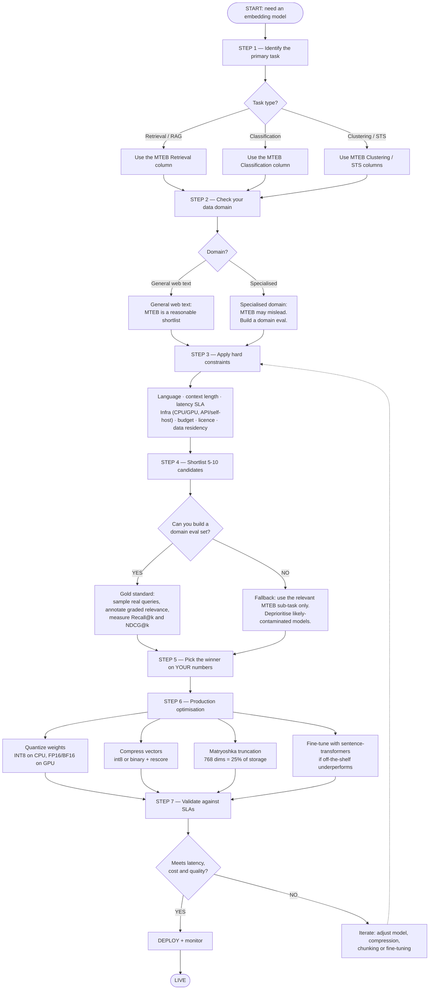

# How to Choose an Embedding Model — A Beginner's Guide (Interview Edition)


---


> **Interview habit to build:** when you quote a benchmark number, say the *date and the benchmark version*. "Model X led MTEB (English, v2) as of late 2025" is a strong answer. "Model X is the best" is a weak one.

---

# PART 1 — The Absolute Basics

## 1.1 What is an embedding?

An embedding is a list of numbers that represents the *meaning* of a piece of text.

```text
"How do I reset my password?"   →   [0.021, -0.114, 0.307, ... ]   (768 numbers)
"I forgot my login credentials" →   [0.019, -0.109, 0.298, ... ]   (768 numbers)
"The stock market fell today"   →   [-0.402, 0.551, -0.088, ... ]  (768 numbers)
```

The first two lists are close to each other. The third is far away. That "closeness" is the entire trick behind semantic search: instead of matching words, you match positions in a high-dimensional space.

The number of values in the list (768 above) is the **dimensionality**. Common values are 384, 768, 1024, 1536, 3072.

## 1.2 How do we measure "close"?

The standard measure is **cosine similarity** — the cosine of the angle between two vectors.

$$
\cos(A,B) = \frac{A \cdot B}{\|A\| \, \|B\|}
$$

It ranges from **-1** (opposite meaning direction) to **+1** (identical direction), with 0 meaning unrelated.

### Worked example (do this by hand once)

Let's use 2 dimensions so you can actually see it. Suppose after embedding:

```text
query  q  = [0.6, 0.8]      ("password reset help")
doc    d1 = [0.8, 0.6]      ("Go to Settings > Security > Reset Password")
doc    d2 = [-0.6, 0.8]     ("Manage your email notification preferences")
```

All three are already **unit length** (length = 1), because:

```text
||q||  = sqrt(0.6² + 0.8²) = sqrt(0.36 + 0.64) = sqrt(1.0) = 1
```

When vectors are unit length, the denominator is 1×1 = 1, so cosine similarity is just the **dot product**:

```text
cos(q, d1) = (0.6 × 0.8) + (0.8 × 0.6) = 0.48 + 0.48 = 0.96   ← very similar
cos(q, d2) = (0.6 × -0.6) + (0.8 × 0.8) = -0.36 + 0.64 = 0.28 ← not very similar
```

So the retriever returns `d1` first. That's the whole mechanism.

> **This is why almost everyone L2-normalises embeddings before storing them.** Once every vector has length 1, the expensive cosine formula collapses into a cheap dot product, and the ranking is identical. Expect this as an interview question.

## 1.3 What is MTEB?

**MTEB** = Massive Text Embedding Benchmark, released by Hugging Face in 2022. It was genuinely important: before MTEB, every paper evaluated on its own datasets, so no two results were comparable.

Two versions you must not confuse:

| Benchmark | Scope | Task types |
|---|---|---|
| **MTEB (2022, original paper)** | 56 datasets, 112 languages | 8: classification, clustering, pair classification, reranking, retrieval, STS, summarization, bitext mining |
| **MTEB (English, v2)** | 41 tasks, English only | 7 (bitext mining dropped — it's a cross-language task) |
| **MTEB (Multilingual, v2) / MMTEB** | 250+ languages | 8 |

The leaderboard reports a headline **"Mean (Task)"** average across all tasks, and a **"Mean (Task Type)"** that averages within each category first. The headline number is what most teams sort by. That is the problem this whole document is about.

---

# PART 2 — Why the Leaderboard Is Not Your Answer

## 2.0 The trap, stated plainly

The MTEB average mixes retrieval, clustering, classification, summarization and STS into one number. But a RAG pipeline only uses **retrieval**. A model that is #1 on the average can be #7 on the retrieval sub-task — and retrieval is the only column you care about.

Sorting by the average is like hiring a developer based on their overall GPA when the job is entirely backend Python.

**First correction to your habits:** on the leaderboard, sort by the **Retrieval** column, not Average.

---

## 2.1 Dimension 1 — Benchmark contamination and data leakage

MTEB's datasets are public and on the internet. Models trained after those datasets were published may have seen them during pre-training or instruction tuning. The leaderboard does not flag this.

If a model has memorised MS MARCO, a high MS MARCO score tells you nothing about how it will behave on your private support tickets.

Research on this: work on **PTEB** and related "moving benchmark" efforts argues that static benchmarks saturate over time from a combination of contamination and models being tuned specifically toward the benchmark distribution.

### Scenario

> Your team picks the #1 model on MTEB retrieval (score 72 on MS MARCO). On your internal insurance-claims corpus, Recall@10 is 0.61. A model ranked #9 on MTEB gets 0.78 on the same set.

That is not a bug. That is exactly what contamination plus domain mismatch looks like. **Trust your eval, not the leaderboard.**

### How to spot it cheaply

- Check the model's release date against the dataset's publication date.
- Check whether the model card lists MTEB datasets in its training mix (many do, honestly).
- Prefer benchmarks like **NanoBEIR** or your own held-out set for the final decision.

---

## 2.2 Dimension 2 — Task mismatch (not the same as contamination)

A model can be genuinely excellent at a task MTEB does not weight heavily. The ICLERB benchmark (2024) found that models which rank mid-table on MTEB — Salesforce's SFR-Embedding-2_R among them — performed strongly on **in-context-learning example retrieval**, a task with different requirements from passage retrieval.

The lesson is not "the leaderboard lies." It's: **the leaderboard measures a weighted mixture of tasks, and your task has weight 1.0 on itself.**

---

## 2.3 Dimension 3 — Domain mismatch

MTEB's retrieval suite is mostly general web text: MS MARCO, TREC, NFCorpus, Wikipedia, news.

If your corpus is legal contracts, radiology reports, semiconductor datasheets, or your company's internal Confluence, MTEB retrieval scores are a *directional hint*, nothing more.

### The evidence

The **Massive Legal Embedding Benchmark (MLEB)**, published October 2025, is a 10-dataset, expert-annotated legal retrieval benchmark scored with NDCG@10. On it, a legal-domain-adapted model (Isaacus **Kanon 2 Embedder**) ranked first out of ~21 models, ahead of general-purpose leaders including OpenAI text-embedding-3-large, Gemini Embedding, Voyage 3 Large, Qwen3-Embedding-8B and Jina Embeddings v4. Notably, it stayed at #1 even when truncated from 1,792 dimensions down to 768.

### Scenario

> **Interviewer:** "We're building search over 2 million medical insurance claim documents. Which embedding model?"
>
> **Weak answer:** "Whatever is #1 on MTEB right now."
>
> **Strong answer:** "MTEB retrieval gives me a shortlist of 5–10 competent general models, but medical claims are a specialised domain with heavy abbreviation use and codes like ICD-10, so I'd expect leaderboard order not to hold. I'd build a 200-query evaluation set from real search logs with graded relevance, measure Recall@20 and NDCG@10, and also include a domain-adapted or fine-tuned candidate. I'd add BM25 as a baseline, because codes like 'ICD-10 J45.909' are exactly what lexical search is best at and dense retrieval is worst at."

That last sentence — knowing when embeddings are the *wrong* tool — is usually what separates a hire from a no-hire.

---

## 2.4 Dimension 4 — Sequence length cliffs

Many MTEB retrieval datasets use short passages (under 256 tokens). So a model whose quality degrades past 512 tokens can still score well.

Two distinct failure modes to keep separate:

1. **Hard truncation.** The model's max sequence length is 512. Your chunk is 900 tokens. Tokens 513–900 are silently discarded. You will not get an error.
2. **Soft degradation.** The model *accepts* 8K tokens but was mostly trained on short text, so the embedding of a long document becomes a mushy average that matches nothing specific.

### The counter-intuitive part

A huge context window is often the *wrong* solution. A 32K-token embedding produces one vector for 32K tokens of text — one point in space representing dozens of topics. Retrieval gets *worse*, not better.

```text
Better:  long document → 20 focused chunks → 20 focused vectors
Worse:   long document → 1 vector that means "generally about insurance, sort of"
```

Long context matters most when a single semantic unit is genuinely long (a full contract clause, a complete function with its docstring).

| Model | Context window |
|---|---|
| Most BERT-based models (BGE, E5, MiniLM, GTE-base) | 512 tokens |
| OpenAI text-embedding-3-small / -large | 8,191 tokens |
| Kanon 2 Embedder | 16,384 tokens |
| Qwen3-Embedding, Jina Embeddings v4 | 32,768 tokens |

> **Practical check before you commit:** tokenize your corpus and plot the chunk-length distribution. If the 95th percentile is 380 tokens, a 512-token model is fine and you just saved a lot of money.

---

## 2.5 Dimension 5 — Cost, and where it actually goes

MTEB ranks quality. It says nothing about cost. But the cost story is more subtle than "pick the cheap one."

### API pricing (verify before quoting — this changes)

| Model | Price per 1M tokens | Batch API |
|---|---|---|
| OpenAI text-embedding-3-small | $0.02 | $0.01 |
| OpenAI text-embedding-3-large | $0.13 | $0.065 |

The large model is **6.5×** the price of the small one (0.13 ÷ 0.02 = 6.5).

### Worked example: what does that actually cost you?

Corpus: 2,000,000 chunks averaging 400 tokens = **800M tokens**.

```text
Initial index build
  3-small:  800M × $0.02/1M = $16
  3-large:  800M × $0.13/1M = $104

Query traffic: 100,000 queries/day × 20 tokens = 2M tokens/day = 60M/month
  3-small:  60M × $0.02/1M = $1.20 / month
  3-large:  60M × $0.13/1M = $7.80 / month
```

**The counter-intuitive conclusion:** for most teams, the embedding API bill is trivial. A $104 one-time cost is not a reason to accept worse retrieval.

So what *does* cost money?

```text
Vector storage + RAM:  2M chunks × 3072 dims × 4 bytes = 24.6 GB of RAM
Same corpus at 768 dims:                                  6.1 GB of RAM
LLM generation tokens:  usually 10-100× the embedding cost
Re-embedding on model change: the full $104 again, plus a migration
```

### The self-hosting break-even

Your draft claimed self-hosting is "1/20th the cost." That is only true at high sustained utilisation. Do the arithmetic:

```text
A100 40GB on a cloud provider:  ~$1.50-2.00/hour  → ~$1,100-1,460/month if always on

At $0.02/1M tokens (3-small), $1,200/month buys you 60 BILLION tokens.
At $0.13/1M tokens (3-large), $1,200/month buys you 9.2 billion tokens.
```

**Break-even:** self-hosting beats the small API only above roughly tens of billions of tokens per month. Below that, the GPU sits idle and you have paid for an ops burden you did not need.

Self-hosting wins for reasons that are usually *not* cost: data residency, no third-party data sharing, no rate limits, ability to fine-tune the weights, and no vendor deprecating your model.

---

## 2.6 Dimension 6 — Quantization and compression (the hidden lever)

Most people deploy at full FP32 because that's what the leaderboard used. This leaves large savings unclaimed. There are **two different things** called quantization here, and interviews love to see whether you can separate them.

### (a) Model quantization — the precision of the model's *weights*

This affects inference speed and GPU memory of the encoder itself.

- On CPU, INT8 typically runs **~2–4× faster** than FP32 with small quality loss.
- On GPU, **FP16 or BF16** is the normal sweet spot.

(The full math of how this works is in document 04 of this set.)

### (b) Vector precision — the precision of the *output embeddings you store*

This affects your vector database size and search latency.

| Precision | Bits/dim | Storage vs FP32 | Typical quality impact |
|---|---|---|---|
| Float32 | 32 | 1× (baseline) | — |
| Float16 / BFloat16 | 16 | 2× smaller | usually under ~1%; measure it |
| Int8 | 8 | 4× smaller | small, recoverable with rescoring |
| Binary (1 bit) | 1 | 32× smaller | large, but recoverable with reranking |

### Binary quantization, worked by hand

Take an 8-dimensional vector and keep only the sign of each value:

```text
v      = [ 0.42, -0.13,  0.77, -0.95,  0.08, -0.31,  0.60, -0.02]
sign   = [   1,     0,     1,     0,     1,     0,     1,     0  ]
packed = 0b10101010 = one single byte
```

Storage: 8 dims × 4 bytes = **32 bytes** → **1 byte**. Exactly 32×.

And comparison becomes a **Hamming distance** — an XOR plus a popcount, which is a single CPU instruction. This is why binary search is not just smaller but dramatically faster.

You lose magnitude information, so relevance drops. The fix is the two-stage pattern in §2.8.

### Matryoshka models — embeddings you can cut in half

Matryoshka Representation Learning trains a model so that the *first* N dimensions of its output are still a usable embedding on their own. You can chop off the tail.

- OpenAI's `text-embedding-3-*` support a `dimensions` parameter (3-large: 3072 → 1024 or 256).
- Gemini Embedding supports 768 / 1536 / 3072.
- Qwen3-Embedding truncates down to 32.
- Kanon 2 Embedder: 1,792 / 1,024 / 768 / 512 / 256.

Storage math for 1M chunks:

```text
3072 dims × 4 bytes × 1M = 12.29 GB
 768 dims × 4 bytes × 1M =  3.07 GB    ← 25% of the cost (768/3072 = 0.25)
 768 dims × 1 byte  × 1M =  0.77 GB    ← truncation + int8 together
```

> **Nuance for the interview:** storage scales exactly linearly with dimensions, so 25% is exact. *Latency* is only roughly linear — ANN index structure, cache behaviour and SIMD width all interfere. Say "storage drops to exactly 25%, latency improves substantially but I'd measure it" rather than claiming both.

---

## 2.7 Dimension 7 — Multilingual blind spots

MTEB (English, v2) is 41 English tasks. MMTEB / MTEB (Multilingual, v2) covers **250+ languages**. Most teams only look at the English board.

If you serve Hindi, Telugu, Arabic or Indonesian users, the English #1 may be a poor choice — and "it uses a multilingual tokenizer" is not the same as "it was trained to align meanings across languages."

Things to check for a multilingual deployment:

- Is it trained for **cross-lingual retrieval** (Hindi query finds English document) or only **multilingual** (Hindi query finds Hindi document)? These are different capabilities.
- What is the tokenizer's fertility on your language? Indic and CJK scripts often consume 2–4× more tokens per word, which affects both cost and effective context length.
- Is your specific language actually in the training mix, or just technically representable?

As of late 2025 / early 2026, NVIDIA's `llama-embed-nemotron-8b` and Qwen3-Embedding-8B were among the strongest open multilingual options, and Cohere Embed v4 among the strongest commercial ones — but check the current board rather than trusting this sentence.

---

## 2.8 Binary vectors and multi-stage ranking

Here is the architecture that makes aggressive compression safe.

```text
Stage 1 — RETRIEVE WIDE, CHEAP
  Binary or int8 vectors over the whole corpus
  Return top 500-1000 candidates
  (fast, tiny memory, imperfect)
          ↓
Stage 2 — RESCORE
  Re-score those 500 candidates with full-precision vectors
  Return top 50
  (you only stored 500 full vectors' worth of work)
          ↓
Stage 3 — RERANK PRECISELY
  Cross-encoder reads (query, passage) together
  Return top 5-10
  (very accurate, only runs on 50 pairs)
          ↓
      LLM generation
```

Binary retrieval alone recovers roughly 80–90% of full-precision relevance on many workloads. The rescore and rerank stages recover the rest. Net result: 32× less memory with near-baseline quality.

> **The bigger point:** obsessing over 0.3 MTEB points between two embedding models is meaningless when adding a reranker moves NDCG@10 by 5–15 points. Architecture beats model selection.

---

## 2.9 Fine-tuning: the most underrated lever

> Fine-tuning an embedding model is far easier than fine-tuning an LLM, and it often has a bigger impact on retrieval quality than swapping models.

Why it's easy:

- Embedding models are small (33M–8B params; most useful ones are 100–350M).
- The training objective (contrastive learning) is simple and stable.
- You need thousands of examples, not millions.
- A fine-tune on ~6,000 pairs of a 110M-parameter model runs in single-digit minutes on a consumer GPU and costs a few cents of compute. (Your draft said "under 4 minutes and less than $0.10" — plausible for that size, but it depends entirely on model size, sequence length and hardware, so don't quote it as a rule.)

Full treatment is in document 02 of this set.

---

# PART 3 — The Decision Framework

Your draft called this "five steps" in prose and drew seven in the flowchart, with mismatched numbering. Here is one consistent seven-step version.



### Step 1 — Identify the primary task
RAG and semantic search → **Retrieval** column. Topic tagging → **Classification**. Deduplication or theme discovery → **Clustering / STS**. Never sort by Average.

### Step 2 — Check the domain
General web text: MTEB order is a reasonable prior. Legal, medical, financial, scientific, code, or internal jargon: treat MTEB as a weak prior only.

### Step 3 — Apply hard constraints (do this *before* quality comparisons)
These eliminate candidates outright, so applying them first saves evaluation effort:

- Context length needed for your chunks
- Languages served, and whether you need cross-lingual retrieval
- Latency SLA for a single query
- Infrastructure: CPU-only? GPU available? API allowed?
- Licence: is commercial use permitted? (Some strong models are non-commercial.)
- Data residency and privacy: can text leave your network at all?
- Budget ceiling for both indexing and storage

### Step 4 — Shortlist 5–10
Take the top 5–10 on the relevant sub-task among the survivors of Step 3. Do not agonise over sub-point differences; the ordering within that group is noise relative to your data.

### Step 5 — Evaluate on YOUR data

This is the step that actually decides. Minimum viable version:

1. Collect 100–300 **real** queries (from search logs, support tickets, or a domain expert).
2. For each query, have someone label the retrieved documents with graded relevance: `2 = directly answers`, `1 = related`, `0 = irrelevant`.
3. Freeze that set. Never tune on it and then report on it.
4. Measure **Recall@k** (did the right chunk make it into the candidate set at all?) and **NDCG@k** (is it ranked near the top?).
5. Compare the ordering to the leaderboard ordering.

> When leaderboard order and your eval order disagree, **trust your eval**. Contamination and domain shift are the default explanation.

### Step 6 — Optimise for production
Quantize weights (INT8 on CPU, FP16/BF16 on GPU). Truncate dimensions if the model is Matryoshka-trained. Reduce stored vector precision, adding a rescore stage if you go to binary. Measure end-to-end latency and cost after each change, not in theory.

### Step 7 — Validate SLAs and deploy behind monitoring
If any of latency, cost or quality fails, loop back to Step 3 — often it's a constraint you set too loosely, not a model problem.

---

# PART 4 — Interview Scenario Bank

Each scenario below follows the same shape: the question, what's being tested, a strong answer, and the answer that fails.

---

### Scenario 1 — The leaderboard trap

> "How do you pick an embedding model for our product search?"

**Being tested:** whether you think in constraints or in rankings.

**Strong:** "First I'd pin down the task — product search is retrieval, so I'd use the retrieval sub-task, not the MTEB average. Then hard constraints: product catalogues are short text, so a 512-token model is fine and cheap; if we serve multiple markets I need multilingual. That gives me a shortlist of maybe six. Then I'd build a 200-query eval from real search logs — product search is one of the rare cases where you *have* click data, so I can derive relevance labels cheaply. I'd also run BM25 as a baseline, because exact SKU and brand matching matters enormously in product search and dense retrieval is weak there. My guess is the final system is hybrid, not pure dense."

**Fails:** "I'd use the top model on MTEB."

---

### Scenario 2 — Retrieval is bad and you don't know why

> "Recall@10 is 0.55. The team wants to switch to a bigger embedding model. What do you do?"

**Being tested:** whether you debug or whether you reach for the most expensive knob.

**Strong:** "Switching models is the last thing I'd try, because it's the most expensive change and may not be the bottleneck. I'd first check whether the right chunk *exists* in the index at all — if the PDF parser flattened the table the answer lives in, no embedding model will save us. That's an upper bound on recall we can measure directly. Then chunking: if answers routinely span a chunk boundary, I'd change the chunking strategy. Then I'd check whether queries and documents used the correct prompt prefixes for this model — with E5, forgetting `query:` / `passage:` silently costs several points. Then I'd add BM25 and fuse. Only after that would I compare models, and I'd probably compare *fine-tuning the current one* against swapping, since fine-tuning usually wins on a specialised corpus."

**Fails:** "Upgrade to the largest model available."

---

### Scenario 3 — Cost pressure

> "Our vector database costs $4,000/month. Cut it without hurting quality."

**Being tested:** whether you know the compression stack.

**Strong:** "Storage cost is linear in `chunks × dimensions × bytes_per_dim`, so there are three independent levers. First, dimensions: if the model is Matryoshka-trained, truncating 3072 → 768 cuts storage to exactly 25% — I'd measure NDCG@10 at each truncation and take the largest cut with acceptable loss. Second, precision: int8 is another 4× on top of that with small loss. Third, chunk count: if we have heavy overlap or near-duplicate documents, deduplication may remove a chunk of the index for free. If I need more than that, binary vectors plus a full-precision rescore stage gets to 32× — the rescore stage is what keeps quality, so I'd never ship binary without it. I'd re-run the frozen eval set after each step and stop at the first one that costs real quality."

**Fails:** "Use a smaller model."

---

### Scenario 4 — The specialised domain

> "We're doing semantic search over Indian legal judgments, mostly English with Hindi and regional-language citations. What's your plan?"

**Being tested:** domain awareness plus honesty about uncertainty.

**Strong:** "Three things make this hard. One: legal is a domain where general models demonstrably underperform — MLEB showed a legal-adapted model beating OpenAI, Gemini and Voyage on legal retrieval, so I'd expect a specialised or fine-tuned model to matter here. Two: mixed-script content means I need a genuinely multilingual model, and I'd check whether it does cross-lingual retrieval or only same-language. Three: judgments are long and citation-heavy, so citation strings like 'AIR 1973 SC 1461' are exact-match objects — those belong in BM25, not dense retrieval, and I'd build a hybrid from day one. For evaluation I'd need a lawyer to label maybe 150 queries; without domain expert labels I'm guessing. And I'd consider fine-tuning on (question, relevant paragraph) pairs, since legal language is exactly the kind of specialised vocabulary where fine-tuning pays off most."

**Fails:** naming a model without mentioning evaluation.

---

### Scenario 5 — The trick question

> "Model A scores 68.2 on MTEB. Model B scores 68.5. Which do you pick?"

**Being tested:** whether you understand measurement noise.

**Strong:** "Neither, on that basis. A 0.3-point gap on an aggregate benchmark is well within noise from prompt formatting, evaluation seed and dataset overlap, and neither number is measured on my data. I'd pick on the constraints instead — context length, licence, latency, cost, whether it's self-hostable — and if both survive, I'd run both on my own eval set and pick the winner there. If they tie there too, I'd take the smaller and cheaper one."

**Fails:** "Model B, it scores higher."

---

### Scenario 6 — Migration

> "We want to swap our embedding model in production. What breaks?"

**Being tested:** whether you understand that embedding spaces are not interchangeable.

**Strong:** "Vectors from two different models live in unrelated coordinate systems — you cannot compare a BGE vector to an E5 vector, even if both are 768 dimensions. So a model swap means re-embedding the entire corpus and rebuilding the index; there is no incremental path. Operationally I'd build the new index alongside the old one, run both against a frozen eval set, shadow production traffic against the new index to compare results before cutting over, then switch with a feature flag so rollback is instant. I'd also store the embedding model name and version in the index metadata, so we can never accidentally mix generations. And I'd budget for the re-embedding cost and the double storage during the transition."

**Fails:** "Just change the model name in the config."

---

### Scenario 7 — Latency

> "P99 search latency is 800ms. Target is 200ms. Where do you look?"

**Being tested:** whether you can decompose a latency budget.

**Strong:** "First I'd break the 800ms down by stage: query embedding, ANN search, reranking, and network. They have completely different fixes. If query embedding dominates, the encoder is too big or it's running on CPU — a smaller model or a GPU/ONNX-quantized deployment fixes it. If ANN search dominates, it's index tuning: lower `ef_search` in HNSW or lower `nprobe` in IVF, trading recall for latency, or reduce dimensions. If reranking dominates, shrink the candidate set from 100 to 50, or use a smaller cross-encoder. I'd also check whether we're paying an avoidable network hop to a hosted embedding API on every query — caching embeddings for repeated queries often removes a surprising fraction of traffic. Without the breakdown I'd just be guessing."

**Fails:** "Use a faster index."

---

# Cheat Sheet

```text
EMBEDDING       text → vector of numbers representing meaning
COSINE SIM      angle between vectors; -1 to 1; = dot product if unit-normalised
MTEB            2022 paper: 56 datasets / 8 task types / 112 languages
MTEB (eng, v2)  41 tasks / 7 task types, English only
MMTEB           250+ languages

SORT BY         the sub-task you actually use (Retrieval for RAG), never Average

SIX BLIND SPOTS OF THE LEADERBOARD
  1. Contamination   model may have trained on the test set
  2. Task mismatch   average ≠ your task
  3. Domain          legal/medical/internal ≠ web text
  4. Length          short benchmark passages hide truncation cliffs
  5. Cost            index build is cheap; RAM and re-embedding are not
  6. Language        English #1 says nothing about Hindi

COMPRESSION LEVERS (independent, multiply together)
  Dimensions   3072 → 768 = 25% storage (exact, if Matryoshka)
  Precision    fp32 → int8 = 4×;  fp32 → binary = 32×
  Weights      INT8 on CPU (~2-4× faster);  FP16/BF16 on GPU

PRODUCTION PATTERN
  retrieve wide (cheap/compressed) → rescore (full precision) → rerank (cross-encoder) → generate

THE ONE-LINE ANSWER
  "MTEB gives me a shortlist; my own frozen eval set on my own data picks the winner;
   then I optimise with quantization, truncation and a reranker."
```

---

## Where to go next

- **Document 02** — how to actually fine-tune an embedding model, with the contrastive-loss math worked by hand.
- **Document 03** — the full RAG pipeline: chunking, BM25, hybrid search, RRF, ANN indexes, quantization at scale.
- **Document 04** — what is inside the model: transformer encoders and decoders, quantization math from zero, LoRA and QLoRA.
